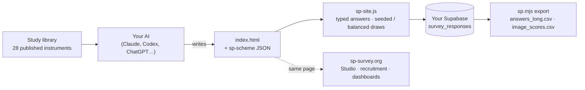

<div align="center">

# SP-Survey · SP-Scheme

**The open standard for AI-built perception experiments.**

AI now lets anyone build a perception survey in minutes.
SP-Scheme makes those surveys **comparable, auditable and poolable**, so studies run by different people in different cities add up.

[](https://sp-survey.org)
[](./LICENSE)
[](./kit/SP-SCHEME.md)
[](./kit/library/studies.json)
[](./kit/library/papers.csv)

[中文说明](#中文说明) · [Quick start](#quick-start-with-your-ai) · [Study library](#the-study-library) · [Spec](./kit/SP-SCHEME.md) · [Hosted platform](https://sp-survey.org)

</div>

---

## Why a standard

Ask Claude, ChatGPT or Codex to "replicate Place Pulse with my street photos" and you get a working page. Ask ten researchers to do it and you get ten question wordings, ten home-made randomisers and ten data formats that cannot be compared. Urban perception research has the same problem at scale: hundreds of studies, few that can be pooled.

SP-Scheme is a small contract between an AI-built survey page and the code that runs it. **The AI designs the experience. The standard fixes the parts that must be right:**

| | What SP-Scheme fixes | Why AI alone can't |
|---|---|---|
| **Questions** | Every recorded answer is a declared question with one of ~30 typed shapes (pairwise choice, rating, sliders, ranking, matrix, annotation…), checked on every answer | Free-form pages record free-form data |
| **Stimuli** | Images are drawn per participant by seeded, tested code; `"balanced"` shows every image equally often across participants (server-claimed numbers) | Balance needs a counter shared by all participants; one page can't do it, and home-made shuffles are often biased |
| **Data** | One response format: answer + exactly which files were shown, per round | Analysis, pooling and dataset release need the same columns everywhere |
| **Provenance** | Studies start from a published instrument in the library, list their differences from the original, and cite one versioned runtime | Reviewers can audit a tested library; they can't audit a one-off script |

The same `index.html` runs **self-hosted** (your server, your Supabase, your data) or on **[sp-survey.org](https://sp-survey.org)** (recruitment links, dashboards, citable dataset packages), unchanged.

## Quick start with your AI

```bash
git clone https://github.com/Sijie-Yang/SP-Survey.git && cd SP-Survey
```

Open the folder in **Claude Code** or **Codex** and say what you want. The repository ships an agent skill ([`.claude/skills/sp-scheme`](./.claude/skills/sp-scheme/SKILL.md), also read through [`AGENTS.md`](./AGENTS.md)), so the agent follows the standard on its own:

> *"Replicate Place Pulse 2.0 safety comparisons with the street photos in ~/photos/singapore, in English and Chinese. Show me the page on my phone."*

> *"I want to know whether trees make streets feel cooler. Design a short experiment from published studies, 10 minutes per person."*

> *"Here is a paper PDF. Add its questionnaire to the study library and open a pull request."*

No agent? The same steps by hand (Node 18+, no install):

```bash
node kit/sp.mjs library safety                          # published studies + matching papers
node kit/sp.mjs new my-study --from 2016-dubey-place    # a running study with the original questions
cp ~/photos/*.jpg my-study/stimuli/
node kit/sp.mjs check my-study                          # validates the page, lists media, explains the draws
node kit/sp.mjs serve my-study                          # http://localhost:4173 — responses saved locally
node kit/sp.mjs export my-study                         # answers_long.csv + image_scores.csv
```

## Go live

**Self-host (your data never leaves your accounts)**

1. Create a free [Supabase](https://supabase.com) project → SQL Editor → run [`kit/supabase.sql`](./kit/supabase.sql).
2. Put the project URL and the **anon** key in `my-study/sp-config.json` (never the service-role key).
3. Deploy the folder to any static host: Cloudflare Pages, Netlify, Vercel, GitHub Pages, a university web server.
4. Download data: `SUPABASE_URL=… SUPABASE_SERVICE_ROLE_KEY=… node kit/sp.mjs export my-study`.

Prolific / MTurk style links work: `?PROLIFIC_PID=…` becomes the participant id, and `completionUrl` in `sp-config.json` sends people back when they finish.

**Or use the hosted platform.** Zip the folder and drop it into Studio on [sp-survey.org](https://sp-survey.org), or connect your agent to `https://sp-survey.org/mcp`. You get recruitment links per country, live results, AI-assisted analysis and a citable dataset package, with no server to run.

## How it works



| File | What it is |
|---|---|
| [`kit/SP-SCHEME.md`](./kit/SP-SCHEME.md) | The standard: page contract, question types, answer shapes, media rules (identical to the text sp-survey.org gives models) |
| [`kit/sp-site.js`](./kit/sp-site.js) | Runtime (one file, no dependencies): `window.SPSite`, answer checks, Fisher–Yates and balanced draws, storage, resume after reload |
| [`kit/sp.mjs`](./kit/sp.mjs) | `library`, `new`, `check`, `serve`, `export` |
| [`kit/supabase.sql`](./kit/supabase.sql) | Response table, idempotent submit, balanced-draw claims (same schema as the platform) |
| [`kit/library/`](./kit/library/) | 28 published study instruments + an index of 1,529 perception papers |
| [`.claude/skills/sp-scheme`](./.claude/skills/sp-scheme/SKILL.md) | Agent skill: design → page → check → deploy → analyse → contribute |

Responses are stored as one row per participant: `responses` (answer per question; repeated rounds as `{trials:[{value, shown_images}]}`), `displayed_images`, and `survey_metadata` (balanced-draw number and claim, timing, URL parameters, runtime version). `node --test kit/kit.test.mjs` checks the balance guarantee, the export and every library study.

## The study library

28 instruments rebuilt from published papers, each with its original wording and scales and an explicit list of differences from the original: Place Pulse 1.0 and 2.0, Streetscore, UrbanGems, SPECS, Scenic-Or-Not, Ewing & Handy's urban design qualities, Gehl's 12 criteria, Attention Restoration Theory, bikeability, playability, greenery, thermal comfort, window views, hotel hue… Plus [`papers.csv`](./kit/library/papers.csv): 1,529 perception studies from the paper library on sp-survey.org (kept up to date by a weekly literature scan and manual review).

**The library grows by contribution.** Give your agent a paper and ask it to add the study (skill step 6); it rebuilds the questionnaire, lists the differences and opens a pull request. Every merged study becomes something anyone can replicate in one command, and every replication cites the original.

## Classic app

The full visual builder this repository started as (Builder, Media, Host, Results, SAM annotation, Silicon pretests) is still here and still works: `npm install && npm run dev`, then see [docs/classic-app.md](./docs/classic-app.md). It is no longer the recommended starting point.

## 中文说明

**SP-Scheme 是给"AI 做感知实验"定的开放标准。** 现在用 Claude、ChatGPT 或 Codex 几分钟就能做出一个问卷页面，但每个人做出来的题目写法、随机方式和数据格式都不一样，结果没法比较，也没法合并。SP-Scheme 只规定三件必须做对的事：

1. 每道题有固定的类型和答案格式；
2. 图片由经过测试的代码按参与者抽取，可以设为均衡，让每张图被看的次数相同；
3. 统一的数据格式，记录每个回答和当时展示的图片。

页面长什么样完全交给 AI 设计。

用法：把仓库用 Claude Code 或 Codex 打开，直接说"用我的新加坡街景复现 Place Pulse 2.0 的安全感对比"。仓库自带 skill，AI 会按标准一步步完成：选研究、生成页面、校验、本地试跑、部署到你自己的 Supabase、导出数据。同一个页面也可以原样上传到 [sp-survey.org](https://sp-survey.org)，用平台的招募链接和分析功能。

研究库目前收录 28 个已发表研究的原版问卷，另有 1,529 篇感知研究论文的索引。把一篇论文交给你的 AI，它可以帮你把这项研究加进库里并提交 PR。

## Citation

If you run a study with SP-Scheme, cite the original study you replicated and the software ([`CITATION.cff`](./CITATION.cff)):

```bibtex
@software{spsurvey,
  title  = {SP-Survey and the SP-Scheme standard for perception experiments},
  author = {{Urban Analytics Lab, National University of Singapore} and Yang, Sijie},
  year   = {2026},
  url    = {https://github.com/Sijie-Yang/SP-Survey}
}
```

The SP-Survey platform paper is a manuscript under review; this section will be updated once it is published.

## License & community

Code: [MIT](./LICENSE). Spec, documentation and study library: CC BY 4.0. Questions, ideas and study showcases: [GitHub Discussions](https://github.com/Sijie-Yang/SP-Survey/discussions). Built by the [Urban Analytics Lab](https://ual.sg), National University of Singapore.
