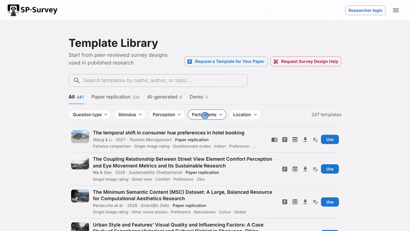

<div align="center">

# SP-Survey

**Run image-based perception surveys. Start from 230+ published studies, or describe yours and let an AI write it.**

[](https://github.com/Sijie-Yang/SP-Survey)
[](https://sp-survey.org)
[](./TEMPLATES.md)
[](https://www.sciencedirect.com/science/article/pii/S0360132325000514)
[](https://creativecommons.org/licenses/by/4.0/)



[Template library](./TEMPLATES.md) · [Hosted platform](https://sp-survey.org) · [Quick start](#quick-start) · [Discussions](https://github.com/Sijie-Yang/SP-Survey/discussions)

</div>

SP-Survey is an open-source tool for studies where people look at streets, buildings, landscapes or interiors (images, video or audio) and say what they perceive: safer, greener, more beautiful, more comfortable.

- **Start from a published study.** Place Pulse, Streetscore, Scenic-Or-Not, Kaplan's restoration scale and 230+ more are rebuilt as surveys you can rerun or adapt.
- **Or describe your study.** In Studio you write one paragraph and the AI writes the whole participant page. A page is saved only when it passes the SP-Scheme check, so responses are always recorded in a form the platform can analyse.
- **Keep your data.** No login. Projects are local files, responses and media go to your own Supabase, and you deploy the participant site yourself.

If this saves you time, a ⭐ helps other researchers find it.

## Template library

<!-- templates:start (written by scripts/build-template-catalog.mjs) -->
**232 published perception studies** are rebuilt as ready-to-run surveys, from 1876 to 2027, across 41 countries and regions.

- **Stimuli:** Scene photos 101 · Street view 81 · Rendered 29 · Indoor 14 · Panorama 12 · Video 8 · Audio 8
- **Tasks:** Multi-scale rating 105 · Rating 70 · Questionnaire 69 · Pairwise 40 · Custom page 33 · Choose / rank 23

| Study | Paper | Task |
|---|---|---|
| Place Pulse 2.0: Six Urban Perceptions (16 cities) | [Dubey A. et al. (2016)](https://doi.org/10.1007/978-3-319-46448-0_12), *ECCV (Lecture Notes in Computer Science)* | Pairwise |
| Place Pulse 1.0: Safety, Class and Uniqueness (4 cities) | [Salesses P. et al. (2013)](https://doi.org/10.1371/journal.pone.0068400), *PLOS ONE* | Pairwise |
| Streetscore: Which Place Looks Safer? (New York, Boston) | [Naik N. et al. (2014)](https://doi.org/10.1109/cvprw.2014.121), *IEEE CVPR Workshops* | Pairwise |
| Scenic-Or-Not: Scenic Beauty Ratings | [Seresinhe C.I. et al. (2017)](https://doi.org/10.1098/rsos.170170), *Royal Society Open Science* | Rating |
| UrbanGems: Beautiful, Quiet, Happy? (London) | [Quercia D. et al. (2014)](https://doi.org/10.1145/2531602.2531613), *ACM CSCW* | Pairwise |
| Urban Design Qualities via Video Assessment | [Ewing R. et al. (2009)](https://doi.org/10.1080/13574800802451155), *Journal of Urban Design* | Multi-scale rating |
| ART – Restorative Streetscape Perception | [Kaplan S. (1995)](https://doi.org/10.1016/0272-4944%2895%2990001-2), *Journal of Environmental Psychology* | Multi-scale rating, Questionnaire |
| The Evaluative Image of the City via Map Annotation | [Nasar J.L. (1990)](https://doi.org/10.1080/01944369008975742), *Journal of the American Planning Association* | Map annotation, Questionnaire |
| Scenic Beauty Estimation (SBE) – Arizona ponderosa pine forests | [Terry C. Daniel et al. (1976)](https://www.fs.usda.gov/rm/pubs_rm/rm_rp167.pdf), *USDA Forest Service Research Paper RM-167* | Rating |
| Golden section rectangles – which shape pleases most? | [Gustav Theodor Fechner (1876)](https://archive.org/details/vorschulederaest12fechuoft), *Leipzig: Breitkopf & Härtel (book)* | Choose / rank, Custom page |

**[See all 232 in TEMPLATES.md](./TEMPLATES.md)** · [browse and preview them online](https://sp-survey.org/templates)
<!-- templates:end -->

Published a perception study? [Request a template for your paper](https://sp-survey.org/request-template).

## Quick start

Requires Node.js 22+ (or 20.19+).

```bash
git clone https://github.com/Sijie-Yang/SP-Survey.git
cd SP-Survey
npm install
npm run dev
```

Open http://localhost:3000/studio and click **Start from the example**. You get a working study with a participant preview, with no key and no account (the image slots fill in once you connect Supabase and upload images). Then:

- **Studio** (describe a study, the AI writes the page): http://localhost:3000/studio
- **Classic editor** (build question by question): http://localhost:3000/admin
- Local survey: http://localhost:3000/survey · local API: http://localhost:3001

To use the AI, add your model key (Claude, OpenAI, DeepSeek, OpenRouter, Qwen, …) in the AI Assistant settings. Keys stay on your computer in `data/`, which Git ignores.

Don't want to install anything? The [hosted platform](https://sp-survey.org) has the same features.

## Run a study

1. **Supabase.** Create a project at [supabase.com](https://supabase.com). On the editor's **Dataset** tab, enter the project URL, anon key and `service_role` key. Upload images there, import from Hugging Face, or download street views with the street-level helper.
2. **Design.** In Studio, describe the study and let the AI write the SP-Scheme page, or drop in a page your own AI built. Or build it question by question in the classic editor.
3. **Check.** Use the preview, Researcher Practice and the local survey link, including on a phone.
4. **Host.** On the **Host** tab, run [`supabase/setup.sql`](./supabase/setup.sql) in Supabase → SQL Editor (safe to run again after updates). Release the draft, build the participant site, push it to GitHub and import it in Vercel with:
   ```text
   REACT_APP_SUPABASE_URL=https://your-project.supabase.co
   REACT_APP_SUPABASE_ANON_KEY=your-anon-key
   ```
   Submit one test response and check it in Supabase → `survey_responses`.
5. **Share and analyze.** Copy the link or QR code on **Share** (recruitment platforms such as Prolific included). Responses appear in **Results**, with charts, AI analysis and exports.

Changes reach participants only after you release again and redeploy.

## What is included

Studio, the AI Assistant (SP-Scheme and Classic modes), image, video and audio questions, repeated trials, balanced image draws, annotation and SAM pre-annotation, custom skills, recruitment platforms, Results with AI analysis, and silicon pretests. These are the same survey and research features as [sp-survey.org](https://sp-survey.org). Only the infrastructure differs:

| | Hosted platform | SP-Survey (this repo) |
|---|---|---|
| Access | Account | No login |
| Projects | Managed | Local JSON files in `public/projects/` |
| Media and responses | Managed | Your Supabase |
| Participant site | Hosted | You deploy it (e.g. Vercel) |
| AI models | Your key or the free model | Your key |
| Templates | Full library, one click | A built-in set; the full library can be previewed and downloaded at [sp-survey.org/templates](https://sp-survey.org/templates) |

## Use with Codex, Claude Code or Cursor

While `npm run dev` is running, a local agent API (this machine only) lets a coding agent create and edit projects, validate, release and read results. Start with `GET http://localhost:3001/api/agent`, which lists every endpoint; see [AGENTS.md](./AGENTS.md). Agent reads never include credentials. Enter keys only in the SP-Survey interface, never in a chat.

## Security

- Never commit or deploy the `service_role` key. The participant site gets only the URL and anon key.
- `.env`, local projects, backups, responses and keys are ignored by Git.
- Check consent, data retention and your institution's rules before collecting data.
- Found a vulnerability? See [SECURITY.md](./SECURITY.md).

## Development

```bash
CI=true npm test -- --watchAll=false
npm run test:server
npm run build
node scripts/build-template-catalog.mjs   # rebuild TEMPLATES.md from docs/templates.json
```

## Citation

Cite the software with GitHub's **Cite this repository** button (from [CITATION.cff](./CITATION.cff)). If you use a template, cite its paper too. The study SP-Survey was first built for:

```bibtex
@article{yang2025thermal,
  title={Thermal comfort in sight: Thermal affordance and its visual assessment for sustainable streetscape design},
  author={Yang, Sijie and Chong, Adrian and Liu, Pengyuan and Biljecki, Filip},
  journal={Building and Environment},
  pages={112569},
  year={2025},
  publisher={Elsevier}
}
```

## Community

Questions, ideas and studies you ran with SP-Survey are welcome in [GitHub Discussions](https://github.com/Sijie-Yang/SP-Survey/discussions)（中文也可以）.

## License

[CC BY 4.0](https://creativecommons.org/licenses/by/4.0/) — Urban Analytics Lab, National University of Singapore.
