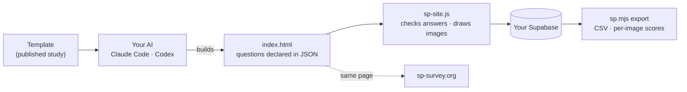

<div align="center">

# SP-Survey

**Visual perception surveys, built by your own AI, run on your own server.**

Tell Claude Code or Codex what you want to measure. SP-Survey gives it the templates, the survey runtime and the data pipeline, so the survey it builds draws images correctly, records answers properly and lands in your own database.

[](https://sp-survey.org)
[](./LICENSE)
[](./kit/templates/templates.json)

[中文说明](#中文说明) · [Quick start](#quick-start) · [Templates](#templates) · [Hosted version](https://sp-survey.org)

</div>

---

## What it is

SP-Survey is an open-source tool for image-based surveys in urban research and beyond: "which street looks safer?", rate a scene, sliders, rankings, annotation. [sp-survey.org](https://sp-survey.org) is the hosted version. This repository is the **self-hosted version for the AI era**: your AI is the survey builder, and SP-Survey supplies the parts an AI should not improvise.

| You (with your AI) | SP-Survey takes care of |
|---|---|
| Describe the study, or pick a template from a published paper | ~30 question types with answers checked on every submit |
| Let the AI design the page: any layout, language, style | Images drawn per participant: random, or **balanced** so every image is shown equally often |
| Preview on your laptop and phone | Recording exactly which images each person saw, per round |
| Deploy anywhere static | Responses in **your own Supabase**: nobody else holds your participants' data |
| Ask the AI to analyse | Export to tidy CSV + per-image scores, ready for pandas / R |

The same survey page also runs on [sp-survey.org](https://sp-survey.org) unchanged, if you would rather not run a server.

## Quick start

```bash
git clone https://github.com/Sijie-Yang/SP-Survey.git && cd SP-Survey
```

**With Claude Code or Codex** (recommended): open the folder and just ask. The repo ships an agent skill ([`.claude/skills/sp-survey`](./.claude/skills/sp-survey/SKILL.md), also read via [`AGENTS.md`](./AGENTS.md)), so the agent knows the whole workflow:

> *"Make a survey where people pick which of two street photos looks safer, using the photos in ~/photos/singapore. English and Chinese. Show it to me on my phone."*

> *"Start from the Place Pulse 2.0 template, keep only safety and liveliness, 15 pairs each."*

> *"Here are 300 responses. Rank the streets by perceived safety and make a figure."*

**By hand** (Node 18+, nothing to install):

```bash
node kit/sp.mjs templates safety                          # templates from published studies
node kit/sp.mjs new my-survey --template 2016-dubey-place # a working survey with the original questions
cp ~/photos/*.jpg my-survey/stimuli/
node kit/sp.mjs check my-survey                           # checks the page and explains how images are drawn
node kit/sp.mjs serve my-survey                           # preview at http://localhost:4173, test answers saved locally
node kit/sp.mjs export my-survey                          # answers_long.csv + image_scores.csv
```

## Publish

1. Create a free [Supabase](https://supabase.com) project → SQL Editor → run [`kit/supabase.sql`](./kit/supabase.sql).
2. Put the project URL and the **anon** key in `my-survey/sp-config.json` (never the service-role key).
3. Deploy the folder to any static host: Cloudflare Pages, Netlify, Vercel, GitHub Pages, your university web server. Share the link.
4. Download responses: `SUPABASE_URL=… SUPABASE_SERVICE_ROLE_KEY=… node kit/sp.mjs export my-survey`.

Recruitment platforms work out of the box: `?PROLIFIC_PID=…` (or `?participant=`, `?pid=`, `?workerId=`) becomes the participant id, and `completionUrl` in `sp-config.json` sends people back when they finish.

**Prefer hosted?** Zip the folder and drop it into Studio on [sp-survey.org](https://sp-survey.org), or connect your agent to `https://sp-survey.org/mcp`. You get recruitment links, live results, AI-assisted analysis and a citable dataset package without running anything.

## How it works



| File | What it does |
|---|---|
| [`kit/SP-SCHEME.md`](./kit/SP-SCHEME.md) | How a survey page declares its questions and records answers (the format sp-survey.org uses) |
| [`kit/sp-site.js`](./kit/sp-site.js) | Survey runtime, one file, no dependencies: answer checks, random and balanced image draws, saving, resume after reload |
| [`kit/sp.mjs`](./kit/sp.mjs) | `templates`, `new`, `check`, `serve`, `export` |
| [`kit/supabase.sql`](./kit/supabase.sql) | Response table, duplicate-safe submit, balanced-draw numbers |
| [`kit/templates/`](./kit/templates/) | 28 templates rebuilt from published studies |
| [`.claude/skills/sp-survey`](./.claude/skills/sp-survey/SKILL.md) | The agent workflow: design → page → check → publish → analyse |

Balanced draws: each new participant gets a number from your database, and the runtime turns it into that person's images with a seeded queue, so after any number of participants every image has been shown the same number of times (± 1) and nobody sees an image twice. `node --test kit/kit.test.mjs` checks this, the export and every template.

## Templates

28 surveys rebuilt from published papers, each with its original wording and scales and a note on how it differs from the original: Place Pulse 1.0 and 2.0, Streetscore, UrbanGems, SPECS, Scenic-Or-Not, Ewing & Handy's urban design qualities, Gehl's 12 quality criteria, Attention Restoration Theory, bikeability, places for play, greenery, thermal comfort, window views, hotel hue and more. The full, growing library is on [sp-survey.org](https://sp-survey.org).

Have a paper whose survey should be a template? Give it to your agent (skill step 6), or [request it](https://sp-survey.org/request-template).

## Classic app

The visual builder this repository started as (Builder, Media, Host, Results, SAM annotation, Silicon pretests) is still here and still works: `npm install && npm run dev`, then see [docs/classic-app.md](./docs/classic-app.md).

## 中文说明

**SP-Survey 开源版：让你自己的 AI 帮你做街景、图片感知问卷，并部署在你自己的服务器上。**

用 Claude Code 或 Codex 打开这个仓库，直接说出你的需求，比如"做一个问卷，让参与者从两张街景里选出看起来更安全的那张，图片在 ~/photos 里，要中英文"。仓库自带 skill，AI 会按 SP-Survey 的流程完成整件事：选模板、设计页面、本地预览、部署、收数据、导出分析。

页面的样子由 AI 按你的想法设计。必须做对的部分由 SP-Survey 的代码负责，包括：

- 约 30 种题型，每个答案都会校验；
- 图片按参与者抽取，可以设为**均衡**，让每张图被看到的次数一样；
- 记录每个人当时看到的是哪几张图；
- 数据存在**你自己的 Supabase**；
- 导出整理好的 CSV 和每张图的得分。

仓库附带 28 个按已发表论文复原的问卷模板（Place Pulse、Streetscore、SPECS 等）。同一个问卷页面也可以原样上传到 [sp-survey.org](https://sp-survey.org)，直接使用平台的招募链接和在线分析。

## Citation

Please cite the software ([`CITATION.cff`](./CITATION.cff)) and, if you used a template, the original study:

```bibtex
@software{spsurvey,
  title  = {SP-Survey},
  author = {{Urban Analytics Lab, National University of Singapore} and Yang, Sijie},
  year   = {2026},
  url    = {https://github.com/Sijie-Yang/SP-Survey}
}
```

The SP-Survey platform paper is a manuscript under review; this section will be updated once it is published.

## License & community

Code: [MIT](./LICENSE). Documentation and templates: CC BY 4.0. Questions and showcases: [GitHub Discussions](https://github.com/Sijie-Yang/SP-Survey/discussions). Built by the [Urban Analytics Lab](https://ual.sg), National University of Singapore.
