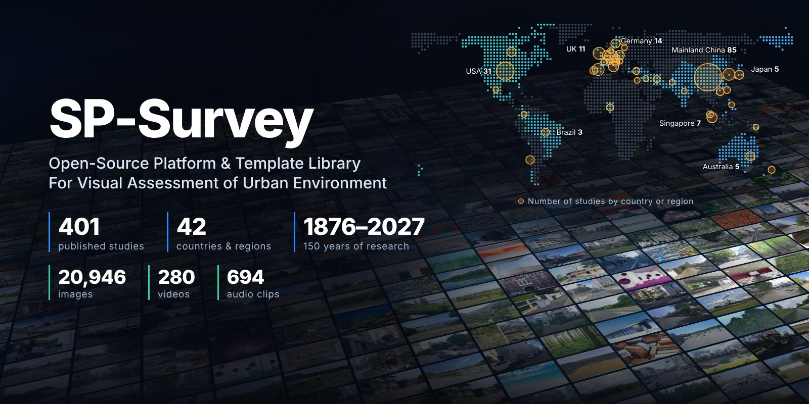

<div align="center">

<p></p>

<p><picture><source media="(prefers-color-scheme: dark)" srcset="./docs/logos-dark.png"></picture></p>

[**Template library**](#template-library) &nbsp;·&nbsp; [**Add your study**](#add-your-study) &nbsp;·&nbsp; [**Run it yourself**](#run-it-yourself) &nbsp;·&nbsp; [**Hosted platform**](https://sp-survey.org)

[](https://github.com/Sijie-Yang/SP-Survey/stargazers)
[](#template-library)
[](https://www.sciencedirect.com/science/article/pii/S0360132325000514)
[](https://creativecommons.org/licenses/by/4.0/)

</div>

<br>

SP-Survey is an open-source tool for studies where people look at streets, buildings, landscapes or interiors (images, video or audio) and say what they perceive: safer, greener, more beautiful, more comfortable.

<p></p>

- **Start from a published study.** Place Pulse, Streetscore, Scenic-Or-Not, Kaplan's restoration scale and 300+ more are rebuilt as surveys you can rerun or adapt.
- **Or describe your own.** In Studio you write one paragraph and the AI writes the whole participant page. A page is saved only when it passes the SP-Scheme check, so responses are always recorded in a form the platform can analyse.
- **Keep your data.** No login. Projects are local files, responses and media go to your own Supabase, and you deploy the participant site yourself.

<div align="center">

**New studies are added every month.** [⭐ Star the repo](https://github.com/Sijie-Yang/SP-Survey) to follow them, and to help other researchers find it.

</div>

## Add your study

This list grows by contributions. If you ran an image-based perception study, published or not, send the survey materials and it becomes a template that others can rerun and cite.

- **With a pull request:** copy [`contributions/_template/`](./contributions/_template) to `contributions/<year>-<first-author>-<keyword>/`, fill in `study.md`, add your survey materials and images, and open the PR.
- **Without git:** open an [Add a study](https://github.com/Sijie-Yang/SP-Survey/issues/new?template=add-study.yml) issue and drag your files in.
- **Without a GitHub account:** fill in the [Add a template](https://sp-survey.org/add-template) form on sp-survey.org. It asks for the paper's title, authors and link, and takes your images and other files.

We build the template from your materials, publish it at [sp-survey.org/templates](https://sp-survey.org/templates), and add the row here with your name on it. What to send is described in [contributions/README.md](./contributions/README.md).

Something wrong in a template of your paper? [Open an issue](https://github.com/Sijie-Yang/SP-Survey/issues) and we will fix it or take it down.

## Run it yourself

Requires Node.js 22+ (or 20.19+).

```bash
git clone https://github.com/Sijie-Yang/SP-Survey.git
cd SP-Survey
npm install
npm run dev
```

Open http://localhost:3000/studio and click **Start from the example**: a working study with a participant preview, with no key and no account. Open http://localhost:3000/templates to browse the whole template library and start a project from any study; every template is a file in [`public/project_templates/`](./public/project_templates), mirrored from the online library once a month. Their images, video and audio load from the online library; a full copy is archived under [Releases](https://github.com/Sijie-Yang/SP-Survey/releases). To collect real responses you connect your own Supabase and deploy the participant site; [docs/GETTING_STARTED.md](./docs/GETTING_STARTED.md) walks through it. Don't want to install anything? The [hosted platform](https://sp-survey.org) has the same features.

## Template library

<!-- templates:start (written by scripts/build-template-catalog.mjs; do not edit this list by hand) -->
**319 published perception studies**, from 1876 to 2027, across 48 countries and regions. Each one is rebuilt as a ready-to-run survey: [preview, use or download it at sp-survey.org/templates](https://sp-survey.org/templates). Snapshot of 2026-11-28.

**Recently added:** Alpine Landscape Liking (rating) · Meadows and Lawns: First Impressions and Attractiveness Ratings (Tübingen) · Building and Background Trees - Height Ratio Integration Rating

[Street view](#street-view) (84) · [Panorama and 360°](#panorama-and-360) (6) · [Landscape, nature and other scene photos](#landscape-nature-and-other-scene-photos) (150) · [Rendered and simulated scenes](#rendered-and-simulated-scenes) (54) · [Indoor](#indoor) (5) · [Window view](#window-view) (1) · [Video](#video) (6) · [Sound](#sound) (5) · [Map](#map) (3) · [In situ](#in-situ) (3) · [Other](#other) (2) · [Demos and examples](#demos-and-examples) (10)

### Street view

| Year | Study |
|---|:---|
| 2026 | [**Sidewalk Audit: Walking Needs and Well-being (Santa Cruz de Tenerife)**](https://sp-survey.org/templates?preview=2026-belaroussi-sidewalk)<br>[Belaroussi R. et al. (2026)](https://doi.org/10.3390/ai7030110), *AI (Switzerland)* · Multi-scale rating, Rating · Santa Cruz de Tenerife, Spain |
| 2026 | [**How Safe Does This Street Look? Rio de Janeiro 15-second safety rating**](https://sp-survey.org/templates?preview=2026-de-how)<br>[Andres De La Puente et al. (2026)](https://arxiv.org/abs/2608.21686), *Computers & Graphics (arXiv preprint)* · Rating · Rio de Janeiro, Brazil |
| 2026 | [**How Does This Street Make You Feel? Taipei street-view walks and 16 emotions**](https://sp-survey.org/templates?preview=2026-ho-how)<br>[Ho L.-C. et al. (2026)](https://doi.org/10.1177/23998083251348280), *Environment and Planning B: Urban Analytics and City Science* · Multi-scale rating · Taipei, Taiwan |
| 2026 | [**Pedestrian Safety Perception in Futian, Shenzhen (1–7 Rating)**](https://sp-survey.org/templates?preview=2026-huang-pedestrian)<br>[Huang Z. et al. (2026)](https://doi.org/10.3390/buildings16050920), *Buildings* · Rating · Shenzhen, Mainland China |
| 2026 | [**Which Place Looks Safer? Helsingborg pairwise street-view safety**](https://sp-survey.org/templates?preview=2026-kang-decoding)<br>[Kang Y. et al. (2026)](https://doi.org/10.1016/j.compenvurbsys.2025.102356), *Computers, Environment and Urban Systems* · Pairwise · Helsingborg, Sweden |
| 2026 | [**Fear of Crime: Which Street Feels Safer? (Seoul)**](https://sp-survey.org/templates?preview=2026-kim-fear)<br>[Kim S. et al. (2026)](https://doi.org/10.3390/ijgi15010018), *ISPRS International Journal of Geo-Information* · Pairwise · Seoul, South Korea |
| 2026 | [**Street Perception of Residents and Tourists in Xi'an**](https://sp-survey.org/templates?preview=2026-kuang-street)<br>[Kuang B. et al. (2026)](https://doi.org/10.1371/journal.pone.0345073), *PLOS ONE* · Multi-scale rating · Xi'an, Mainland China |
| 2026 | [**Campus Streetscape Pairwise Comparison (China) – safe, lively, beautiful**](https://sp-survey.org/templates?preview=2026-lin-campus)<br>[Lin Y. et al. (2026)](https://doi.org/10.3390/buildings16081623), *Buildings* · Pairwise · Beijing, Nanjing, Wuhan, Xiamen, Tianjin, Mainland China |
| 2026 | [**Public Art and Restorative Streets**](https://sp-survey.org/templates?preview=2026-liu-public)<br>[Liu L. et al. (2026)](https://doi.org/10.3390/buildings16030593), *Buildings* · Multi-scale rating, Questionnaire · Wuhan, Mainland China |
| 2026 | [**Street Intervention Before–After Preferences (GSV Time Travel)**](https://sp-survey.org/templates?preview=2026-lopes-street-gsv)<br>[Lopes M.I. et al. (2026)](https://doi.org/10.1016/j.landurbplan.2026.105686), *Landscape and Urban Planning* · Pairwise, Multi-scale rating, Questionnaire · Lisbon, Barcelona, Auckland, Brussels, Portugal, Spain, New Zealand, United States, Belgium, Brazil |
| 2026 | [**Street Comfort in Zibo: Twelve Roads**](https://sp-survey.org/templates?preview=2026-ma-street)<br>[Ma H. et al. (2026)](https://doi.org/10.3390/su18052220), *Sustainability (Switzerland)* · Rating · Zibo, Mainland China |
| 2026 | [**Street Review: rating Montréal streets for inclusivity, aesthetics, practicality and accessibility**](https://sp-survey.org/templates?preview=2026-mushkani-street)<br>[Rashid Mushkani et al. (2026)](https://doi.org/10.1016/j.cities.2025.106602), *Cities* · Multi-scale rating · Montréal, Canada |
| 2026 | [**Which Place Looks Greener? Greenery Perception (SPECS, 5 cities)**](https://sp-survey.org/templates?preview=2026-quintana-greenery)<br>[Quintana M. et al. (2026)](https://doi.org/10.1016/j.landurbplan.2026.105618), *Landscape and Urban Planning* · Pairwise, Questionnaire · Abuja, Amsterdam, Santiago, Singapore, San Francisco, Nigeria, Netherlands, Chile, United States |
| 2026 | [**Townscape Quality in Shenyang Fangcheng (SBE + Semantic Differential)**](https://sp-survey.org/templates?preview=2026-tang-townscape)<br>[Tang N. et al. (2026)](https://doi.org/10.3390/buildings16071455), *Buildings* · Multi-scale rating · Shenyang, Mainland China |
| 2026 | [**Child-Friendly Streets (Shanghai, children 7–12)**](https://sp-survey.org/templates?preview=2026-tu-childfriendly)<br>[Tu H. et al. (2026)](https://doi.org/10.1371/journal.pone.0342430), *PLOS ONE* · Rating · Shanghai, Mainland China |
| 2025 | [**Safety Perception of Street Views (Wuhan) – three-level rating**](https://sp-survey.org/templates?preview=2025-chen-safety)<br>[Chen Y. et al. (2025)](https://doi.org/10.3390/su17177641), *Sustainability (Switzerland)* · Rating · Wuhan, Mainland China |
| 2025 | [**Which Cycling Environment Appears Safer?**](https://sp-survey.org/templates?preview=2025-costa-which)<br>[Costa M. et al. (2025)](https://doi.org/10.1109/tits.2024.3507639), *IEEE Transactions on Intelligent Transportation Systems* · Pairwise · Berlin, Germany |
| 2025 | [**Percept: Citizen Ratings of Amsterdam Street Views**](https://sp-survey.org/templates?preview=2025-danish-citizen)<br>[Danish M. et al. (2025)](https://doi.org/10.1016/j.compenvurbsys.2024.102207), *Computers, Environment and Urban Systems* · Multi-scale rating · Amsterdam, Netherlands |
| 2025 | [**Effective Perception Survey**](https://sp-survey.org/templates?preview=2025-gu-effective)<br>[Gu Y. et al. (2025)](https://doi.org/10.1016/j.landurbplan.2025.105368), *Landscape and Urban Planning* · Pairwise, Rating · Singapore |
| 2025 | [**Old Residential Street Perceptions (Wuchang, Wuhan) – six dimensions**](https://sp-survey.org/templates?preview=2025-guo-old)<br>[Guo Z. et al. (2025)](https://doi.org/10.1038/s41598-025-28936-0), *Scientific Reports* · Multi-scale rating · Wuhan, Mainland China |
| 2025 | [**Visual Walkability of Commercial Streets (Fukuoka Tenjin)**](https://sp-survey.org/templates?preview=2025-huang-visual)<br>[Huang G. et al. (2025)](https://doi.org/10.3390/buildings15010113), *Buildings* · Multi-scale rating · Fukuoka, Japan |
| 2025 | [**Perceived Restorativeness of Streetscapes (Guangzhou Liwan)**](https://sp-survey.org/templates?preview=2025-kang-perceived)<br>[Kang W. et al. (2025)](https://doi.org/10.3390/buildings15203671), *Buildings* · Multi-scale rating · Guangzhou, Mainland China |
| 2025 | [**US Built Environment Quality: Street Comparisons with Strength Slider**](https://sp-survey.org/templates?preview=2025-larkin-us)<br>[Larkin A. et al. (2025)](https://doi.org/10.1021/acs.est.5c00966), *Environmental Science and Technology* · Pairwise · Boston, Philadelphia, Columbus, Kansas City, Atlanta, Nashville, Dallas, Denver, Portland, United States |
| 2025 | [**Street Restorative Perception (Shanghai Huangpu) – RCS 15 items**](https://sp-survey.org/templates?preview=2025-lei-street)<br>[Lei Y. et al. (2025)](https://doi.org/10.1038/s41598-025-02841-y), *Scientific Reports* · Multi-scale rating · Shanghai, Mainland China |
| 2025 | [**Street Multi-Activity Potential (SMAP)**](https://sp-survey.org/templates?preview=2025-li-street)<br>[Li J. et al. (2025)](https://doi.org/10.1016/j.compenvurbsys.2025.102350), *Computers, Environment and Urban Systems* · Multi-scale rating · Beijing, Mainland China |
| 2025 | [**Women's Street Safety Perception in Dalian**](https://sp-survey.org/templates?preview=2025-li-womens)<br>[Li Y. et al. (2025)](https://doi.org/10.3390/buildings15183310), *Buildings* · Multi-scale rating · Dalian, Mainland China |
| 2025 | [**Visual Appeal of Helsinki Streets: 360° panorama rating**](https://sp-survey.org/templates?preview=2025-malekzadeh-visual)<br>[Milad Malekzadeh et al. (2025)](https://arxiv.org/abs/2511.05570), *arXiv preprint* · Rating · Helsinki, Finland |
| 2025 | [**Campus Walking Perception (Yangtze River Delta) – four questions**](https://sp-survey.org/templates?preview=2025-qin-campus)<br>[Qin Y. et al. (2025)](https://doi.org/10.1371/journal.pone.0321028), *PLoS ONE* · Multi-scale rating · Wuxi, Hangzhou, Nanjing, Shanghai, Mainland China |
| 2025 | [**SPECS**](https://sp-survey.org/templates?preview=2025-quintana-specs)<br>[Quintana M. et al. (2025)](https://doi.org/10.1038/s44284-025-00330-x), *Nature Cities* · Pairwise, Questionnaire |
| 2025 | [**Historic District Perceptions (Shanghai) – seven dimensions**](https://sp-survey.org/templates?preview=2025-wang-historic)<br>[Wang Z. et al. (2025)](https://doi.org/10.3390/su172411075), *Sustainability (Switzerland)* · Multi-scale rating · Shanghai, Mainland China |
| 2025 | [**Walkability Through Different Lenses (Michigan street pairs)**](https://sp-survey.org/templates?preview=2025-wedyan-walkability)<br>[Wedyan M. et al. (2025)](https://doi.org/10.1371/journal.pone.0322078), *PLoS ONE* · Rating, Questionnaire · Lansing, East Lansing, Williamston, United States |
| 2025 | [**Restorative Campus Spaces at Southeast University (PRS-11 Panoramas)**](https://sp-survey.org/templates?preview=2025-wu-restorative)<br>[Wu T. et al. (2025)](https://doi.org/10.3390/land14030610), *Land* · Multi-scale rating · Nanjing, Mainland China |
| 2025 | [**Perceived Walkability of Xi'an Streets: Professionals and Residents**](https://sp-survey.org/templates?preview=2025-xiao-perceived)<br>[Xiao Y. et al. (2025)](https://doi.org/10.1080/12265934.2024.2429824), *International Journal of Urban Sciences* · Rating · Xi'an, Mainland China |
| 2025 | [**Riverfront Streets of Suzhou: Beauty and Uniqueness**](https://sp-survey.org/templates?preview=2025-xiong-riverfront)<br>[Xiong X. et al. (2025)](https://doi.org/10.3390/land14102039), *Land* · Multi-scale rating · Suzhou, Mainland China |
| 2025 | [**Emotional Perception of Old Residential Streets (Yangzhou) – six dimensions**](https://sp-survey.org/templates?preview=2025-xu-emotional)<br>[Xu Y. et al. (2025)](https://doi.org/10.3390/ijgi14120471), *ISPRS International Journal of Geo-Information* · Multi-scale rating · Yangzhou, Mainland China |
| 2025 | [**Scenic Beauty of Historic Districts (Wuhan)**](https://sp-survey.org/templates?preview=2025-xu-scenic)<br>[Xu H. et al. (2025)](https://doi.org/10.3390/buildings15234338), *Buildings* · Multi-scale rating · Wuhan, Mainland China |
| 2025 | [**Thermal Comfort in Sight**](https://sp-survey.org/templates?preview=2025-yang-thermal)<br>[Yang S. et al. (2025)](https://doi.org/10.1016/j.buildenv.2025.112569), *Building and Environment* · Pairwise · Singapore |
| 2025 | [**Coastal Road Scenes in Xiamen: Beauty and Uniqueness**](https://sp-survey.org/templates?preview=2025-zhang-coastal)<br>[Yu Zhang et al. (2025)](https://doi.org/10.1371/journal.pone.0317585), *PLOS ONE* · Multi-scale rating · Xiamen, Mainland China |
| 2025 | [**Which Place Looks Safer? Human Anchor Set for LLM Comparison**](https://sp-survey.org/templates?preview=2025-zhang-which)<br>[Jiaxin Zhang et al. (2025)](https://doi.org/10.1016/j.cities.2025.106122), *Cities* · Pairwise · Osaka, Chengdu, Japan, Mainland China |
| 2025 | [**Street Design Qualities in Tianjin: Five Pairwise Perceptions**](https://sp-survey.org/templates?preview=2025-zhou-street)<br>[Zhou S. et al. (2025)](https://doi.org/10.3390/ijgi14100391), *ISPRS International Journal of Geo-Information* · Pairwise · Tianjin, Mainland China |
| 2024 | [**Spiritual Perception of Lhasa Street Panoramas – 16 items**](https://sp-survey.org/templates?preview=2024-gadan-spiritual)<br>[Gadan D. et al. (2024)](https://doi.org/10.1371/journal.pone.0301087), *PLoS ONE* · Multi-scale rating · Lhasa, Mainland China |
| 2024 | [**Walking Preference: Street Segments and Intersections (Tokyo)**](https://sp-survey.org/templates?preview=2024-huang-walking)<br>[Huang L. et al. (2024)](https://doi.org/10.3390/ijgi13040131), *ISPRS International Journal of Geo-Information* · Pairwise · Tokyo, Japan |
| 2024 | [**Architectural Color Perception (Changsha) – 10-item rating**](https://sp-survey.org/templates?preview=2024-li-architectural)<br>[Li X. et al. (2024)](https://doi.org/10.3390/buildings14123901), *Buildings* · Multi-scale rating · Changsha, Mainland China |
| 2024 | [**Building Exterior Perception**](https://sp-survey.org/templates?preview=2024-liang-building)<br>[Liang X. et al. (2024)](https://doi.org/10.1016/j.buildenv.2024.111875), *Building and Environment* · Pairwise, Rating · Singapore, San Francisco, Amsterdam, United States, Netherlands |
| 2024 | [**Healthy Streets in Shanghai's Inner City (9 Health Statements)**](https://sp-survey.org/templates?preview=2024-shao-healthy)<br>[Shao Y. et al. (2024)](https://doi.org/10.3390/land13010048), *Land* · Multi-scale rating · Shanghai, Mainland China |
| 2024 | [**Seniors' Sense of Safety in Living Streets (Tianjin)**](https://sp-survey.org/templates?preview=2024-sun-seniors)<br>[Sun X. et al. (2024)](https://doi.org/10.3390/buildings14123973), *Buildings* · Multi-scale rating · Tianjin, Mainland China |
| 2024 | [**Street Visual Quality in Beijing and Shanghai (Which Place Looks Better?)**](https://sp-survey.org/templates?preview=2024-wang-street)<br>[Wang R. et al. (2024)](https://doi.org/10.3390/buildings14113332), *Buildings* · Pairwise · Beijing, Shanghai, Mainland China |
| 2024 | [**Psychological Stress Perception of Street Views (Shanghai) – 12-item rating**](https://sp-survey.org/templates?preview=2024-zhang-psychological)<br>[Zhang T. et al. (2024)](https://doi.org/10.3389/fpubh.2024.1402536), *Frontiers in Public Health* · Multi-scale rating · Shanghai, Mainland China |
| 2024 | [**Streetscape Visual Complexity in Tianjin (Low / Medium / High)**](https://sp-survey.org/templates?preview=2024-zhao-streetscape)<br>[Zhao J. et al. (2024)](https://doi.org/10.3390/land13111953), *Land* · Rating · Tianjin, Mainland China |
| 2023 | [**Which Location Looks Safer? Raleigh street-view pairs before and after the Great Recession**](https://sp-survey.org/templates?preview=2022-freitas-which)<br>[Freitas F. et al. (2023)](https://doi.org/10.1007/s00146-022-01592-y), *AI and Society* · Pairwise · Raleigh, United States |
| 2023 | [**Women-Oriented Street Safety in Guangzhou**](https://sp-survey.org/templates?preview=2023-cui-womenoriented)<br>[Cui Q. et al. (2023)](https://doi.org/10.3390/buildings13030715), *Buildings* · Rating · Guangzhou, Mainland China |
| 2023 | [**Spatial Quality of Living Streets (Hengyang) – 6-dimension rating**](https://sp-survey.org/templates?preview=2023-duan-spatial)<br>[Duan J. et al. (2023)](https://doi.org/10.3390/su151310623), *Sustainability (Switzerland)* · Multi-scale rating · Hengyang, Mainland China |
| 2023 | [**Walkability Perceptions in Shanghai's New Towns (Pairwise Street Views)**](https://sp-survey.org/templates?preview=2023-gong-walkability)<br>[Gong W. et al. (2023)](https://doi.org/10.3390/land12071339), *Land* · Pairwise · Shanghai, Mainland China |
| 2023 | [**Residential Streetscapes of Seoul in 360° (SP-Scheme)**](https://sp-survey.org/templates?preview=2023-han-residential)<br>[Jaewon Han et al. (2023)](https://doi.org/10.3390/land12020345), *Land* · Multi-scale rating · Seoul, South Korea |
| 2023 | [**Restorative Perception of Urban Streets (Shenzhen) – RCS 15 items**](https://sp-survey.org/templates?preview=2023-han-restorative)<br>[Han X. et al. (2023)](https://doi.org/10.3389/fpubh.2023.1141630), *Frontiers in Public Health* · Multi-scale rating · Shenzhen, Mainland China |
| 2023 | [**Safety Perception and Question Framing (Stockholm)**](https://sp-survey.org/templates?preview=2023-kang-assessing)<br>[Kang Y. et al. (2023)](https://doi.org/10.1016/j.landurbplan.2023.104768), *Landscape and Urban Planning* · Pairwise · Stockholm, Sweden |
| 2023 | [**Perceived Walkability: Street View Pairs (Jeonju)**](https://sp-survey.org/templates?preview=2023-kang-perceived)<br>[Kang Y. et al. (2023)](https://doi.org/10.3390/ijgi12050186), *ISPRS International Journal of Geo-Information* · Pairwise · Jeonju, South Korea |
| 2023 | [**Political Graffiti and Neighborhood Ratings**](https://sp-survey.org/templates?preview=2023-pollmanns-political)<br>[Claas Pollmanns et al. (2023)](https://doi.org/10.3389/fpsyg.2023.1098105), *Frontiers in Psychology* · Multi-scale rating, Rating · Germany |
| 2023 | [**How Much Greenery Do You See? (Helsinki, 0–100)**](https://sp-survey.org/templates?preview=2023-torkko-how)<br>[Torkko J. et al. (2023)](https://doi.org/10.3389/frsc.2023.1160995), *Frontiers in Sustainable Cities* · Rating · Helsinki, Finland |
| 2023 | [**Street Spatial Quality Pairwise Comparison (Hangzhou)**](https://sp-survey.org/templates?preview=2023-wang-street)<br>[Wang J. et al. (2023)](https://doi.org/10.3390/ijgi12010015), *ISPRS International Journal of Geo-Information* · Pairwise · Hangzhou, Mainland China |
| 2023 | [**Street Perceptions in Greater London (8 Pairwise Indicators)**](https://sp-survey.org/templates?preview=2023-yang-street)<br>[Yang S. et al. (2023)](https://doi.org/10.3390/ijgi12060249), *ISPRS International Journal of Geo-Information* · Pairwise · London, United Kingdom |
| 2022 | [**Billboards and Street Pleasantness in Kuala Lumpur (SP-Scheme)**](https://sp-survey.org/templates?preview=2022-adam-billboards)<br>[Adam M. et al. (2022)](https://doi.org/10.3390/ijgi11120630), *ISPRS International Journal of Geo-Information* · Rating · Kuala Lumpur, Malaysia |
| 2022 | [**Street Space Quality for Older Adults' Leisure Activity in Guangzhou**](https://sp-survey.org/templates?preview=2022-du-street)<br>[Du Y. et al. (2022)](https://doi.org/10.3390/ijgi11040241), *ISPRS International Journal of Geo-Information* · Rating · Guangzhou, Mainland China |
| 2022 | [**Commercial Pedestrian Streets in South China: Scene Preference**](https://sp-survey.org/templates?preview=2022-huang-commercial)<br>[Xulin Huang et al. (2022)](https://doi.org/10.1371/journal.pone.0264482), *PLOS ONE* · Rating · Nanning, Guangzhou, Shenzhen, Wuzhou, Liuzhou, Huizhou, Mainland China |
| 2022 | [**Visual Complexity, Safety and Preference of Streets**](https://sp-survey.org/templates?preview=2022-kawshalya-visual)<br>[Kawshalya L.W.G. et al. (2022)](https://doi.org/10.1371/journal.pone.0272074), *PLoS ONE* · Multi-scale rating, Questionnaire · Colombo, Sri Lanka |
| 2022 | [**Perceptions of Washington State Streets: nature quality, beauty, relaxation and safety slider comparisons**](https://sp-survey.org/templates?preview=2022-larkin-perceptions)<br>[Larkin A. et al. (2022)](https://doi.org/10.1038/s41370-022-00489-8), *Journal of Exposure Science and Environmental Epidemiology* · Pairwise · Seattle, Tacoma, Spokane, United States |
| 2022 | [**Which Street Would You Prefer to Walk On? (London, SP-Scheme)**](https://sp-survey.org/templates?preview=2022-muller-which)<br>[Emily Muller et al. (2022)](https://arxiv.org/abs/2211.12139), *arXiv* · Pairwise · London, United Kingdom |
| 2022 | [**Street Design Qualities (Shanghai)**](https://sp-survey.org/templates?preview=2022-qiu-subjective)<br>[Qiu W. et al. (2022)](https://doi.org/10.1016/j.landurbplan.2022.104358), *Landscape and Urban Planning* · Pairwise · Shanghai, Mainland China |
| 2022 | [**Street Visual Quality in Hexi, Tianjin: Six Expert Ratings**](https://sp-survey.org/templates?preview=2022-zhao-street)<br>[Zhao J. et al. (2022)](https://doi.org/10.3390/su14138166), *Sustainability (Switzerland)* · Multi-scale rating · Tianjin, Mainland China |
| 2021 | [**Bikeability Perception of Street Views (Singapore, Tokyo)**](https://sp-survey.org/templates?preview=2021-ito-assessing)<br>[Ito K. et al. (2021)](https://doi.org/10.1016/j.trc.2021.103371), *Transportation Research Part C: Emerging Technologies* · Multi-scale rating · Singapore, Tokyo, Japan |
| 2021 | [**Places for Play: Playability of Street Views (Boston)**](https://sp-survey.org/templates?preview=2021-kruse-places)<br>[Kruse J. et al. (2021)](https://doi.org/10.1016/j.compenvurbsys.2021.101693), *Computers, Environment and Urban Systems* · Rating · Boston, United States |
| 2021 | [**Heterogeneous Perception of Safety: Santiago Street Pairs**](https://sp-survey.org/templates?preview=2021-ramirez-measuring)<br>[Ramírez T. et al. (2021)](https://doi.org/10.1016/j.landurbplan.2020.104002), *Landscape and Urban Planning* · Pairwise · Santiago, Chile |
| 2021 | [**Emotional responses to Beijing street scenes – 360° panoramas**](https://sp-survey.org/templates?preview=2021-zhang-emotional)<br>[Zijiao Zhang et al. (2021)](https://doi.org/10.3390/ijerph18189677), *International Journal of Environmental Research and Public Health* · Multi-scale rating · Beijing, Mainland China |
| 2020 | [**Contemplative Landscape Model Scores of Downtown Singapore Walks (SP-Scheme)**](https://sp-survey.org/templates?preview=2020-hou-contemplative)<br>[Hou Yanru et al. (2020)](https://doi.org/10.3390/rs12213517), *Remote Sensing* · Multi-scale rating · Singapore |
| 2019 | [**Street View Perception Scoring (Wuhan)**](https://sp-survey.org/templates?preview=2019-yao-human)<br>[Yao Y. et al. (2019)](https://doi.org/10.1080/13658816.2019.1643024), *International Journal of Geographical Information Science* · Rating · Wuhan, Mainland China |
| 2017 | [**Street Panorama Visual Perception (Nanjing) – five grades**](https://sp-survey.org/templates?preview=2017-cheng-street)<br>[Cheng L. et al. (2017)](https://doi.org/10.3390/ijgi6090265), *ISPRS International Journal of Geo-Information* · Multi-scale rating · Nanjing, Mainland China |
| 2017 | [**Perceived Naturalness of Edinburgh Street View (1–7 rating)**](https://sp-survey.org/templates?preview=2017-hyam-perceived)<br>[Roger Hyam (2017)](https://doi.org/10.1371/journal.pone.0169357), *PLOS ONE* · Rating · Edinburgh, United Kingdom |
| 2017 | [**Facade Quality and Street-Wall Continuity (Beijing)**](https://sp-survey.org/templates?preview=2017-liu-machine)<br>[Liu L. et al. (2017)](https://doi.org/10.1016/j.compenvurbsys.2017.06.003), *Computers, Environment and Urban Systems* · Rating · Beijing, Mainland China |
| 2016 | [**Place Pulse 2.0: Six Urban Perceptions (16 cities)**](https://sp-survey.org/templates?preview=2016-dubey-place)<br>[Dubey A. et al. (2016)](https://doi.org/10.1007/978-3-319-46448-0_12), *Lecture Notes in Computer Science* · Pairwise · New York, Boston, Toronto, Mexico City, São Paulo, Santiago, London, Paris, Amsterdam, Stockholm, Linz, Salzburg, Bucharest, Johannesburg, Tokyo, Sydney, United States, Canada, Mexico, Brazil, Chile, United Kingdom, France, Netherlands, Sweden, Austria, Romania, South Africa, Japan, Australia |
| 2016 | [**Perception of Bike Lane Colour: Safety and Liking (15 colour-design pictures)**](https://sp-survey.org/templates?preview=2016-veravillarroel-perception)<br>[Pablo Vera-Villarroel et al. (2016)](https://doi.org/10.1371/journal.pone.0160399), *PLOS ONE* · Multi-scale rating · Santiago, Chile |
| 2014 | [**Streetscore: Which Place Looks Safer? (New York, Boston)**](https://sp-survey.org/templates?preview=2014-naik-streetscore)<br>[Naik N. et al. (2014)](https://doi.org/10.1109/cvprw.2014.121), *2014 IEEE Conference on Computer Vision and Pattern Recognition Workshops* · Pairwise · New York, Boston, United States |
| 2014 | [**UrbanGems: Beautiful, Quiet, Happy? (London)**](https://sp-survey.org/templates?preview=2014-quercia-aesthetic)<br>[Quercia D. et al. (2014)](https://doi.org/10.1145/2531602.2531613), *Proceedings of the 17th ACM conference on Computer supported cooperative work & social computing* · Pairwise · London, United Kingdom |
| 2013 | [**Place Pulse 1.0: Safety, Class and Uniqueness (4 cities)**](https://sp-survey.org/templates?preview=2013-salesses-collaborative)<br>[Salesses P. et al. (2013)](https://doi.org/10.1371/journal.pone.0068400), *PLoS ONE* · Pairwise · New York, Boston, Linz, Salzburg, United States, Austria |
| 1995 | [**ART – Restorative Streetscape Perception**](https://sp-survey.org/templates?preview=1995-kaplan-art)<br>[Kaplan S. (1995)](https://doi.org/10.1016/0272-4944%2895%2990001-2), *Journal of Environmental Psychology* · Multi-scale rating, Questionnaire |

### Panorama and 360°

| Year | Study |
|---|:---|
| 2026 | [**How Walkable Does This Sidewalk Look? 360° sidewalk-view walkability rating**](https://sp-survey.org/templates?preview=2026-damandeh-how)<br>[Moloud Damandeh et al. (2026)](https://arxiv.org/abs/2608.06934), *arXiv preprint* · Rating · Australia |
| 2026 | [**Perceived Walking Comfort: Panorama Pairs (Macau)**](https://sp-survey.org/templates?preview=2026-gong-perceived)<br>[Gong Z. et al. (2026)](https://doi.org/10.3390/buildings16061103), *Buildings* · Pairwise · Macau |
| 2026 | [**Cyclists' Perceived Safety and Comfort**](https://sp-survey.org/templates?preview=2026-xu-cyclists)<br>[Lurong Xu et al. (2026)](https://doi.org/10.1016/j.tra.2025.104850), *Transportation Research Part A: Policy and Practice* · Pairwise · Suzhou, Mainland China |
| 2026 | [**Peony Gardens and Stress Recovery (360° scenes)**](https://sp-survey.org/templates?preview=2026-zhao-peony)<br>[Renlin Zhao et al. (2026)](https://doi.org/10.3389/fpsyg.2026.1935645), *Frontiers in Psychology* · Rating, Questionnaire, Custom page · Xi'an, Mainland China |
| 2023 | [**Clouds in Landscape Photos**](https://sp-survey.org/templates?preview=2023-tasser-clouds)<br>[Tasser E et al. (2023)](https://doi.org/10.1371/journal.pone.0288424), *PLOS ONE* · Rating · Innsbruck, Munich, Austria, Germany |
| 2022 | [**Sky as Nature: Free Selection and Ratings**](https://sp-survey.org/templates?preview=2022-sztuka-sky)<br>[Izabela Maria Sztuka et al. (2022)](https://doi.org/10.3389/fpsyg.2022.932507), *Frontiers in Psychology* · Custom page, Multi-scale rating · United Kingdom |

### Landscape, nature and other scene photos

| Year | Study |
|---|:---|
| 2026 | [**Large Wood in Rivers: Photo Questionnaire**](https://sp-survey.org/templates?preview=2026-abatti-large)<br>[Bruno Henrique Abatti et al. (2026)](https://doi.org/10.1007/s00267-026-02489-y), *Environmental Management* · Multi-scale rating, Open answers, Custom page · Brazil |
| 2026 | [**Microplastics on sand: when does a beach look dirty?**](https://sp-survey.org/templates?preview=2026-asakura-microplastics)<br>[Hiroshi Asakura et al. (2026)](https://doi.org/10.3390/pollutants6020029), *Pollutants* · Choose / rank, Questionnaire · Japan |
| 2026 | [**Climate Images and Feelings: Affective Environmental Images**](https://sp-survey.org/templates?preview=2026-asutay-climate)<br>[Erkin Asutay (2026)](https://doi.org/10.3389/fpsyg.2026.1944740), *Frontiers in Psychology* · Multi-scale rating, Questionnaire |
| 2026 | [**Community Park Scenes: Walking Intention and Feelings**](https://sp-survey.org/templates?preview=2026-chen-community)<br>[Yuhui Chen et al. (2026)](https://doi.org/10.1038/s41598-026-48324-6), *Scientific Reports* · Multi-scale rating, Questionnaire · Xiamen, Nanchang, Yancheng, Mainland China |
| 2026 | [**Urban Regeneration Streetscapes: Perception and Emotion**](https://sp-survey.org/templates?preview=2026-cheng-urban)<br>[Cheng X et al. (2026)](https://doi.org/10.3389/fpsyg.2026.1874589), *Frontiers in Psychology* · Multi-scale rating · Chengdu, Mainland China |
| 2026 | [**Urban Rewilding Scenarios - Design Option Choice**](https://sp-survey.org/templates?preview=2026-cirella-urban)<br>[Giuseppe T. Cirella et al. (2026)](https://doi.org/10.1038/s41598-025-32655-x), *Scientific Reports* · Choose / rank · Sopot, Poland |
| 2026 | [**Forest Healing Landscape in Summer and Autumn (PRS-11)**](https://sp-survey.org/templates?preview=2026-kim-forest)<br>[Soyeon Kim (2026)](https://doi.org/10.3390/ijerph23040425), *International Journal of Environmental Research and Public Health* · Multi-scale rating, Questionnaire · Gangwon Province, South Korea |
| 2026 | [**Urban Green Space Affective Ratings**](https://sp-survey.org/templates?preview=2026-latifzadeh-urban)<br>[Kayhan Latifzadeh et al. (2026)](https://doi.org/10.1145/3772318.3791826), *Proceedings of the 2026 CHI Conference on Human Factors in Computing Systems* · Multi-scale rating, Choose / rank · Esch-sur-Alzette, Luxembourg |
| 2026 | [**Hospital Landscapes - Visual Comfort Rating**](https://sp-survey.org/templates?preview=2026-li-hospital)<br>[Li, Y. et al. (2026)](https://doi.org/10.3389/frai.2026.1733709), *Frontiers in Artificial Intelligence* · Rating · Jinan, Hangzhou, Sanya, Mainland China |
| 2026 | [**Night Lighting in Gardens and Parks: Restoration Ratings**](https://sp-survey.org/templates?preview=2026-liu-night)<br>[Dongyu Liu et al. (2026)](https://doi.org/10.3389/fpsyg.2026.1958901), *Frontiers in Psychology* · Multi-scale rating, Questionnaire · Suzhou, Xuzhou, Mainland China |
| 2026 | [**Indoor Greenery: Preference, Relaxation and Restorativeness**](https://sp-survey.org/templates?preview=2026-ma-indoor)<br>[Lin Ma et al. (2026)](https://doi.org/10.3390/land15050741), *Land* · Multi-scale rating, Questionnaire · Mainland China |
| 2026 | [**Geodiversity and Natural Value of Stream Valleys (Photo Choice + Element Rating)**](https://sp-survey.org/templates?preview=2026-miskiewicz-geodiversity)<br>[Krzysztof Miśkiewicz et al. (2026)](https://doi.org/10.3390/su182111403), *Sustainability* · Pairwise, Multi-scale rating, Questionnaire · Poland |
| 2026 | [**Natural Scene Beauty: Minimum Semantic Content Images**](https://sp-survey.org/templates?preview=2026-penacchio-natural)<br>[Olivier Penacchio et al. (2026)](https://doi.org/10.1038/s41597-026-06816-0), *Scientific Data* · Rating · Global |
| 2026 | [**City Birds - Seeing, Naming and Valuing Urban Birds**](https://sp-survey.org/templates?preview=2026-qian-city)<br>[Weiwei Qian et al. (2026)](https://doi.org/10.1016/j.dib.2026.112665), *Data in Brief* · Questionnaire, Open answers, Multi-scale rating · Zhoushan, Mainland China |
| 2026 | [**Scenicness of Listed Buildings in English Towns**](https://sp-survey.org/templates?preview=2026-sherborne-scenicness)<br>[Sidney Sherborne et al. (2026)](https://doi.org/10.3389/fpsyg.2025.1645424), *Frontiers in Psychology* · Rating · United Kingdom |
| 2026 | [**Restorative Tourist Streetscapes – Scene Viewing, Ratings and SART**](https://sp-survey.org/templates?preview=2026-wang-restorative)<br>[Xinliang Wang et al. (2026)](https://doi.org/10.3389/fpubh.2026.1981997), *Frontiers in Public Health* · Multi-scale rating, Custom page · Hong Kong |
| 2026 | [**Street Redesign Choice: Greenery, Bike Lanes and Social Space**](https://sp-survey.org/templates?preview=2026-wicki-street)<br>[Michael Wicki et al. (2026)](https://doi.org/10.1038/s42949-026-00463-5), *npj Urban Sustainability* · Pairwise, Rating, Open answers, Questionnaire · Zurich, Switzerland |
| 2026 | [**Trees, Naturalness and Activity Willingness – Photo Ratings**](https://sp-survey.org/templates?preview=2026-zhao-trees)<br>[Yanxia Zhao et al. (2026)](https://doi.org/10.3389/fpubh.2026.1881655), *Frontiers in Public Health* · Multi-scale rating · Ya'an, Mainland China |
| 2025 | [**Coral reef beauty: restored vs healthy vs degraded (pairwise)**](https://sp-survey.org/templates?preview=2025-alisa-coral)<br>[Cut Aja Gita Alisa et al. (2025)](https://doi.org/10.1038/s41598-025-06373-3), *Scientific Reports* · Pairwise, Questionnaire · Pulau Bontosua, Indonesia |
| 2025 | [**Streetscape Vegetation Choice with Restorative Reasons**](https://sp-survey.org/templates?preview=2025-baniadam-streetscape)<br>[Baniadam P. et al. (2025)](https://doi.org/10.1371/journal.pone.0332493), *PLOS ONE* · Choose / rank, Custom page · Nantes, France |
| 2025 | [**Lake Tisza Anglers: Shore Site Ranking**](https://sp-survey.org/templates?preview=2025-benkhard-lake)<br>[Borbála Benkhard et al. (2025)](https://doi.org/10.3390/land14030600), *Land* · Choose / rank, Open answers, Questionnaire · Hungary |
| 2025 | [**Curved vs Straight Chairs & Tables: Liking at 84 ms and Unlimited Viewing**](https://sp-survey.org/templates?preview=2025-chuquichambi-curved)<br>[Erick G. Chuquichambi et al. (2025)](https://doi.org/10.1177/20416695251341682), *i-Perception* · Rating · United Kingdom |
| 2025 | [**Landscape Aesthetic Quality – Tree Image Ranking & Forest Rating (Jiuzhaigou)**](https://sp-survey.org/templates?preview=2025-liu-landscape)<br>[Junyan Liu et al. (2025)](https://doi.org/10.3390/f16121804), *Forests* · Choose / rank, Rating, Questionnaire · Jiuzhaigou, Mainland China |
| 2025 | [**Rhododendron Forest Scenic Beauty from Drone Photos (SBE rating)**](https://sp-survey.org/templates?preview=2025-liu-rhododendron)<br>[Yan Liu et al. (2025)](https://doi.org/10.3390/horticulturae11080898), *Horticulturae* · Rating, Questionnaire · Liuyang, Mainland China |
| 2025 | [**Deep Space, Stars and Cities: Awe and Affect Ratings**](https://sp-survey.org/templates?preview=2025-martens-deep)<br>[Jason P. Martens et al. (2025)](https://doi.org/10.1002/ijop.70146), *International Journal of Psychology* · Multi-scale rating, Questionnaire · Canada |
| 2025 | [**Chongqing Pocket Parks: Scenic Beauty Estimation (SBE)**](https://sp-survey.org/templates?preview=2025-peng-chongqing)<br>[Xinyi Peng et al. (2025)](https://doi.org/10.3390/su17052020), *Sustainability* · Rating · Chongqing, Mainland China |
| 2025 | [**Flower Colour Preference**](https://sp-survey.org/templates?preview=2025-she-flower)<br>[Juan She et al. (2025)](https://doi.org/10.3390/horticulturae11010054), *Horticulturae* · Rating, Questionnaire · Mainland China |
| 2025 | [**Urban Flower Meadows: Semantic Differential Emotions**](https://sp-survey.org/templates?preview=2025-simonienko-urban)<br>[Katarzyna Simonienko et al. (2025)](https://doi.org/10.1038/s41598-025-16420-8), *Scientific Reports* · Multi-scale rating, Custom page · Białystok, Poland |
| 2025 | [**Hospital Landscape Design Preferences (Trojanowska et al. 2025)**](https://sp-survey.org/templates?preview=2025-trojanowska-hospital)<br>[Monika Trojanowska et al. (2025)](https://doi.org/10.3390/architecture5040091), *Architecture* · Choose / rank, Questionnaire, Open answers · Poland |
| 2025 | [**Forest Greenway Scenes: Perceived Restorativeness by Season and Greenway Type**](https://sp-survey.org/templates?preview=2025-wang-forest)<br>[Wang, H. et al. (2025)](https://doi.org/10.3389/fpsyg.2025.1596154), *Frontiers in Psychology* · Multi-scale rating · Nanjing, Mainland China |
| 2025 | [**Japanese Garden Impressions: 24-Pair Semantic Differential (Rokuon-ji)**](https://sp-survey.org/templates?preview=2025-wang-japanese)<br>[Jinyang Wang et al. (2025)](https://doi.org/10.3389/fpsyg.2025.1594362), *Frontiers in Psychology* · Multi-scale rating, Custom page · Kyoto, Japan |
| 2025 | [**Wairarapa and ZhuZhen Rural Landscape Perception (rating)**](https://sp-survey.org/templates?preview=2025-wang-wairarapa)<br>[Chenfeng Wang (2025)](https://doi.org/10.26686/wgtn.30022492), *PhD thesis, Victoria University of Wellington* · Rating, Multi-scale rating, Questionnaire · Wairarapa, ZhuZhen Town, New Zealand, Mainland China |
| 2025 | [**Yangzhou Ancient Canal: Winter and Summer Scenic Beauty**](https://sp-survey.org/templates?preview=2025-wang-yangzhou)<br>[Yanyan Wang et al. (2025)](https://doi.org/10.1038/s41598-025-91483-1), *Scientific Reports* · Rating · Yangzhou, Mainland China |
| 2025 | [**Small Urban Parks: Perceived Restorativeness of Four Park Types**](https://sp-survey.org/templates?preview=2025-weng-small)<br>[Yuxi Weng et al. (2025)](https://doi.org/10.3389/fpubh.2025.1667502), *Frontiers in Public Health* · Multi-scale rating · Fuzhou, Mainland China |
| 2025 | [**Empirical Aesthetics of Bridges: Four-Scale Ratings**](https://sp-survey.org/templates?preview=2025-yang-empirical)<br>[Mei Yang et al. (2025)](https://doi.org/10.1371/journal.pone.0338493), *PLOS ONE* · Multi-scale rating, Questionnaire · International |
| 2025 | [**English Heritage Gardens: SAM and Preference**](https://sp-survey.org/templates?preview=2025-zhang-english)<br>[Zhang X et al. (2025)](https://doi.org/10.3390/s25030748), *Sensors* · Multi-scale rating · United Kingdom |
| 2025 | [**Urban Green Space Plantscape Beauty (SBE rating)**](https://sp-survey.org/templates?preview=2025-zhang-urban)<br>[Lingling Zhang et al. (2025)](https://doi.org/10.1371/journal.pone.0329119), *PLOS ONE* · Rating · Zhengzhou, Mainland China |
| 2025 | [**Eight Landscapes: Restoration and Preference Ratings**](https://sp-survey.org/templates?preview=2025-zheng-eight)<br>[Chenyu Zheng et al. (2025)](https://doi.org/10.1371/journal.pone.0330694), *PLOS ONE* · Multi-scale rating · Hengyang, Mainland China |
| 2025 | [**Fitness Trail Landscapes: Layout Choice and SD Ratings**](https://sp-survey.org/templates?preview=2025-zhu-fitness)<br>[Wenli Zhu et al. (2025)](https://doi.org/10.3389/fpsyg.2025.1595451), *Frontiers in Psychology* · Choose / rank, Multi-scale rating, Custom page · Shenyang, Mainland China |
| 2024 | [**SNED Nature Picture Ratings**](https://sp-survey.org/templates?preview=2024-bendall-sned)<br>[Robert C. A. Bendall et al. (2024)](https://doi.org/10.3758/s13428-024-02556-4), *Behavior Research Methods* · Multi-scale rating · International |
| 2024 | [**Human Scale in Window Views (indicator choice)**](https://sp-survey.org/templates?preview=2024-fikfak-human)<br>[Fikfak A. et al. (2024)](https://doi.org/10.3390/urbansci8040257), *Urban Science* · Choose / rank · Ljubljana, Slovenia |
| 2024 | [**Symmetry and Beauty in City Photos (rating + keep/delete)**](https://sp-survey.org/templates?preview=2024-gartus-symmetry)<br>[Andreas Gartus et al. (2024)](https://doi.org/10.17605/OSF.IO/TVQEG), *Manuscript submitted for publication (data and stimuli on OSF)* · Rating, Questionnaire · Vienna, Salzburg, Linz, Austria |
| 2024 | [**Front Garden Visual Assessment (rating)**](https://sp-survey.org/templates?preview=2024-gu-front)<br>[Tao Gu et al. (2024)](https://doi.org/10.1371/journal.pone.0296519), *PLOS ONE* · Rating, Questionnaire · Jiangsu, Mainland China |
| 2024 | [**Urban lawns in Perth: views, uses and lawn alternatives**](https://sp-survey.org/templates?preview=2024-ignatieva-urban)<br>[Maria Ignatieva et al. (2024)](https://doi.org/10.3390/land13020191), *Land* · Rating, Choose / rank, Questionnaire, Open answers · Perth, Australia |
| 2024 | [**Scenic Beauty of Waterfront Planting**](https://sp-survey.org/templates?preview=2024-jin-scenic)<br>[Weiwei Jin et al. (2024)](https://doi.org/10.1371/journal.pone.0302855), *PLOS ONE* · Rating · Xi'an, Mainland China |
| 2024 | [**Erosion Control Dam Exteriors**](https://sp-survey.org/templates?preview=2024-kim-erosion)<br>[Yong-Rae Kim et al. (2024)](https://doi.org/10.1371/journal.pone.0309804), *PLOS ONE* · Multi-scale rating · South Korea |
| 2024 | [**Green Office Restorativeness: IRCS Ratings of Office Photos**](https://sp-survey.org/templates?preview=2024-shibata-green)<br>[Seiji Shibata et al. (2024)](https://doi.org/10.3389/fpsyg.2024.1443540), *Frontiers in Psychology* · Multi-scale rating, Custom page · Japan |
| 2024 | [**Flower Border Colours: pleasure rating of 24 photos**](https://sp-survey.org/templates?preview=2024-wan-flower)<br>[Wan, Z. et al. (2024)](https://doi.org/10.3390/f15101688), *Forests* · Rating |
| 2024 | [**Localized Church Facades: Impression and Acceptance**](https://sp-survey.org/templates?preview=2024-wang-localized)<br>[Wang M. et al. (2024)](https://doi.org/10.1016/j.heliyon.2024.e28564), *Heliyon* · Multi-scale rating · Macau, Xi'an, Guiyang, Dali, Luding, Mainland China |
| 2024 | [**Anthropomorphism in House Façades – Adjectives and 12 Statements**](https://sp-survey.org/templates?preview=2024-weber-anthropomorphism)<br>[Sandra Weber et al. (2024)](https://doi.org/10.1038/s41598-024-77839-z), *Scientific Reports* · Multi-scale rating, Open answers · Germany, Denmark, Canada |
| 2024 | [**Campus Landscape Types and Restoration**](https://sp-survey.org/templates?preview=2024-xu-campus)<br>[Xu Y et al. (2024)](https://doi.org/10.3389/fpsyg.2024.1341990), *Frontiers in Psychology* · Choose / rank, Questionnaire · Hefei, Mainland China |
| 2024 | [**Tinted Window Views: 13-Item Rating**](https://sp-survey.org/templates?preview=2024-yu-tinted)<br>[Yu, L. et al. (2024)](https://doi.org/10.3390/buildings14061799), *Buildings* · Multi-scale rating · Huangshan, Mainland China |
| 2024 | [**Historical Irrigation Canals**](https://sp-survey.org/templates?preview=2024-zhong-historical)<br>[Yujia Zhong et al. (2024)](https://doi.org/10.3390/buildings14071955), *Buildings* · Multi-scale rating, Choose / rank · Gaoyou, Mainland China |
| 2023 | [**Campus Courtyard Healing Effect (semantic differential and PRS)**](https://sp-survey.org/templates?preview=2023-cao-campus)<br>[Ying Cao et al. (2023)](https://doi.org/10.3390/su15108369), *Sustainability* · Multi-scale rating, Questionnaire · Beijing, Mainland China |
| 2023 | [**Autumn Colour in Urban Forests: Aesthetic Rating**](https://sp-survey.org/templates?preview=2023-chen-autumn)<br>[Ziru Chen et al. (2023)](https://doi.org/10.3390/f14071491), *Forests* · Rating · Fuzhou, Mainland China |
| 2023 | [**Awe and Beauty in Nature Photos**](https://sp-survey.org/templates?preview=2023-harrison-awe)<br>[Neil Harrison (2023)](https://doi.org/10.7717/peerj.14926), *PeerJ* · Multi-scale rating, Questionnaire · Liverpool, United Kingdom |
| 2023 | [**iratebirds - Rate the Appearance of Birds (1-10 Hearts)**](https://sp-survey.org/templates?preview=2023-haukka-iratebirds)<br>[Anna Haukka et al. (2023)](https://doi.org/10.1038/s41597-023-02169-0), *Scientific Data* · Rating, Questionnaire · Global |
| 2023 | [**Farm Plot Size and Landscape Beauty**](https://sp-survey.org/templates?preview=2023-janeckova-farm)<br>[Kristina Janeckova Molnarova et al. (2023)](https://doi.org/10.3390/ijerph20010687), *International Journal of Environmental Research and Public Health* · Rating · Czech Republic |
| 2023 | [**Lawn or Spontaneous Groundcover (photo ratings)**](https://sp-survey.org/templates?preview=2023-liang-lawn)<br>[Liang H et al. (2023)](https://doi.org/10.3389/fpsyg.2023.1259920), *Frontiers in Psychology* · Multi-scale rating, Questionnaire · Xianyang, Mainland China |
| 2023 | [**Visual Discomfort from Building Frontages**](https://sp-survey.org/templates?preview=2023-penacchio-visual)<br>[Olivier Penacchio et al. (2023)](https://doi.org/10.3389/fnins.2023.1200661), *Frontiers in Neuroscience* · Rating · United Kingdom |
| 2023 | [**Design Intensity in Urban Forests: Preference and Complexity**](https://sp-survey.org/templates?preview=2023-shen-design)<br>[Yuanping Shen et al. (2023)](https://doi.org/10.3390/f14040761), *Forests* · Multi-scale rating · Fuzhou, Mainland China |
| 2023 | [**Scenic Beauty of a Painted Retaining Wall (SBE)**](https://sp-survey.org/templates?preview=2023-song-scenic)<br>[Jialu Song et al. (2023)](https://doi.org/10.1371/journal.pone.0287251), *PLOS ONE* · Multi-scale rating · Jiuzhaigou, Mainland China |
| 2023 | [**Flower Colour: Preference, Uplift and Relaxation**](https://sp-survey.org/templates?preview=2023-zhang-flower)<br>[Liwen Zhang et al. (2023)](https://doi.org/10.1016/j.ufug.2022.127795), *Urban Forestry & Urban Greening* · Choose / rank, Questionnaire, Open answers · UK-wide, United Kingdom |
| 2022 | [**Window Views of Nearby Facades Reactions**](https://sp-survey.org/templates?preview=2022-drobne-window)<br>[S. Drobne et al. (2022)](https://doi.org/10.3390/su14010269), *Sustainability* · Choose / rank · Ljubljana, Slovenia |
| 2022 | [**Crowding at Tulum: Acceptable Number of Visitors (Photo Rating)**](https://sp-survey.org/templates?preview=2022-ensenatsoberanis-crowding)<br>[Fernando Enseñat-Soberanis et al. (2022)](https://doi.org/10.3390/land11101651), *Land* · Rating, Questionnaire · Tulum, Mexico |
| 2022 | [**Tagus Nature Reserve Landscapes: Pairwise Preference (AHP)**](https://sp-survey.org/templates?preview=2022-ferreira-tagus)<br>[Dora Isabel Rodrigues Ferreira et al. (2022)](https://doi.org/10.3390/land11010068), *Land* · Pairwise, Questionnaire · Spain, Portugal |
| 2022 | [**Imageability in Window Views (indicator choice)**](https://sp-survey.org/templates?preview=2022-fikfak-imageability)<br>[Fikfak A. et al. (2022)](https://doi.org/10.3390/land11122157), *Land* · Choose / rank · Ljubljana, Slovenia |
| 2022 | [**Rural Community Streets: Restorative Potential of Nine Street Types**](https://sp-survey.org/templates?preview=2022-fu-rural)<br>[Erkang Fu et al. (2022)](https://doi.org/10.3389/fpubh.2022.861072), *Frontiers in Public Health* · Multi-scale rating · Chengdu, Mainland China |
| 2022 | [**Waterfall Image Impressions**](https://sp-survey.org/templates?preview=2022-jo-waterfall)<br>[Jo H et al. (2022)](https://doi.org/10.3390/ijerph20010565), *International Journal of Environmental Research and Public Health* · Multi-scale rating · Japan |
| 2022 | [**Meadow, Ocean or City View: SART Attention Restoration**](https://sp-survey.org/templates?preview=2022-johnson-meadow)<br>[Katherine A. Johnson et al. (2022)](https://doi.org/10.3389/fpsyg.2022.809629), *Frontiers in Psychology* · Custom page, Multi-scale rating, Questionnaire · Melbourne, Australia |
| 2022 | [**Nature vs Urban Photos: Affect Misattribution Procedure**](https://sp-survey.org/templates?preview=2022-koivisto-nature)<br>[Mika Koivisto et al. (2022)](https://doi.org/10.1016/j.jenvp.2022.101840), *Journal of Environmental Psychology* · Rating, Questionnaire · United Kingdom |
| 2022 | [**Bark Beetle Disturbance and Hiking Well-Being (slider)**](https://sp-survey.org/templates?preview=2022-kortmann-bark)<br>[Mareike Kortmann et al. (2022)](https://doi.org/10.3390/f13111954), *Forests* · Custom page, Questionnaire · Bavarian Forest, Germany |
| 2022 | [**City Blues: Restorativeness and Stimulating Effects of Urban Places**](https://sp-survey.org/templates?preview=2022-lammle-city)<br>[Lämmle L et al. (2022)](https://doi.org/10.3390/ijerph19137606), *International Journal of Environmental Research and Public Health* · Multi-scale rating, Questionnaire · Munich, Germany |
| 2022 | [**Sacred Landscape Preference: Buddhist Temples, Outsiders vs Insiders**](https://sp-survey.org/templates?preview=2022-li-sacred)<br>[Chang Li et al. (2022)](https://doi.org/10.3389/fpsyg.2022.743933), *Frontiers in Psychology* · Rating, Open answers, Custom page · Suzhou, Mainland China |
| 2022 | [**Suzhou Garden vs Park Walking Scenes: Visual Perception**](https://sp-survey.org/templates?preview=2022-li-suzhou)<br>[Chang Li et al. (2022)](https://doi.org/10.3390/land11101766), *Land* · Multi-scale rating, Questionnaire · Suzhou, Mainland China |
| 2022 | [**Rural Buildings and Vegetation Screening - Visual Integration Rating**](https://sp-survey.org/templates?preview=2022-monteroparejo-rural)<br>[Montero-Parejo, M.J. et al. (2022)](https://doi.org/10.3390/land11091450), *Land* · Rating, Questionnaire · Spain |
| 2022 | [**Historic Street Scenes: Visual Quality Rating and Element Tap (Baghdad)**](https://sp-survey.org/templates?preview=2022-mundher-historic)<br>[Mundher, R. et al. (2022)](https://doi.org/10.3390/heritage5040192), *Heritage* · Rating, Map annotation · Baghdad, Iraq |
| 2022 | [**Pocket Park Planting: Coherence, Legibility, Refuge**](https://sp-survey.org/templates?preview=2022-naghibi-pocket)<br>[Maryam Naghibi et al. (2022)](https://doi.org/10.1016/j.mex.2022.101638), *MethodsX* · Choose / rank, Custom page · Tehran, Iran |
| 2022 | [**Mountain Stream Facilities: Preference and Captions (CEM)**](https://sp-survey.org/templates?preview=2022-peng-mountain)<br>[Szu-Hsien Peng et al. (2022)](https://doi.org/10.3390/w14223605), *Water* · Rating, Open answers · Chiayi, Taichung, Taiwan |
| 2022 | [**Perennial Plantings: Preference Rating**](https://sp-survey.org/templates?preview=2022-shi-perennial)<br>[Yangyang Shi et al. (2022)](https://doi.org/10.3390/land11101860), *Land* · Rating · Hangzhou, Mainland China |
| 2022 | [**Flowers, nature and flower drawings: emotional ratings**](https://sp-survey.org/templates?preview=2022-urakami-flowers)<br>[Jacqueline Urakami et al. (2022)](https://doi.org/10.3390/horticulturae8070668), *Horticulturae* · Multi-scale rating, Open answers, Choose / rank, Questionnaire · Japan, Israel |
| 2022 | [**Greener Streets and Tourists' Emotions in Xi'an**](https://sp-survey.org/templates?preview=2022-zhang-greener)<br>[Yanyan Zhang et al. (2022)](https://doi.org/10.3390/ijerph192416918), *International Journal of Environmental Research and Public Health* · Multi-scale rating · Xi'an, Mainland China |
| 2022 | [**Ornamental Plants in Urban Green Space: Preference (rating)**](https://sp-survey.org/templates?preview=2022-zheng-ornamental)<br>[Junming Zheng et al. (2022)](https://doi.org/10.3390/f13111871), *Forests* · Rating, Questionnaire · Mainland China |
| 2022 | [**Garden Depth Perception: Magnitude Estimation**](https://sp-survey.org/templates?preview=2022-zhu-garden)<br>[Haipeng Zhu et al. (2022)](https://doi.org/10.3389/fpsyg.2022.963600), *Frontiers in Psychology* · Rating, Custom page · Suzhou, Mainland China |
| 2021 | [**La Mancha Rural Landscapes: Visual Preference**](https://sp-survey.org/templates?preview=2021-ayugatellez-la)<br>[Esperanza Ayuga-Téllez et al. (2021)](https://doi.org/10.3390/su132413799), *Sustainability* · Rating, Questionnaire · Campo de Criptana, Spain |
| 2021 | [**Mine Spoil-Heap Forests – Walk Rating & Choice Experiment**](https://sp-survey.org/templates?preview=2021-braun-mine)<br>[Markéta Braun Kohlová et al. (2021)](https://doi.org/10.3390/f12020160), *Forests* · Rating, Choose / rank, Questionnaire · Sokolov, Czech Republic |
| 2021 | [**Post-Mining Forests – Perceived Characteristics & Walk Attractiveness**](https://sp-survey.org/templates?preview=2021-braun-postmining)<br>[Markéta Braun Kohlová et al. (2021)](https://doi.org/10.3390/land10090910), *Land* · Multi-scale rating, Rating, Questionnaire · Sokolov, Czech Republic |
| 2021 | [**A Change of Scenery: Nature Images, Delay Discounting and Food Desirability**](https://sp-survey.org/templates?preview=2021-clarke-a)<br>[Katie Clarke et al. (2021)](https://doi.org/10.3389/fpsyg.2021.782056), *Frontiers in Psychology* · Questionnaire, Rating, Custom page · United Kingdom |
| 2021 | [**e-NatPOEM: Nature Photographs and Feelings**](https://sp-survey.org/templates?preview=2021-dal-enatpoem)<br>[Daniela Dal Fabbro et al. (2021)](https://doi.org/10.1038/s41598-021-91013-9), *Scientific Reports* · Multi-scale rating · Brazil |
| 2021 | [**Wooden Facade Renovation Ratings**](https://sp-survey.org/templates?preview=2021-karjalainen-wooden)<br>[Karjalainen M et al. (2021)](https://doi.org/10.3390/ijerph182312316), *International Journal of Environmental Research and Public Health* · Rating, Questionnaire · Helsinki, Finland |
| 2021 | [**Busan Street Tree Preference and Perception (multi-rating, ranking, similarity)**](https://sp-survey.org/templates?preview=2021-kim-busan)<br>[Sang Seup Kim et al. (2021)](https://doi.org/10.3390/su13063141), *Sustainability* · Multi-scale rating, Rating, Choose / rank, Open answers, Questionnaire · Busan, South Korea |
| 2021 | [**Autumn Forest Canopy Gaps – Drone Photo Beauty Rating**](https://sp-survey.org/templates?preview=2021-li-autumn)<br>[Qiaoyu Li et al. (2021)](https://doi.org/10.3390/f12020199), *Forests* · Rating, Questionnaire · Li County, Mainland China |
| 2021 | [**Urban Park Blue Space: Preference and Restoration**](https://sp-survey.org/templates?preview=2021-luo-urban)<br>[Shixian Luo et al. (2021)](https://doi.org/10.3390/land10111233), *Land* · Multi-scale rating, Questionnaire · Chengdu, Mainland China |
| 2021 | [**Familiarity and Biome Preference: 40 Nature Photographs**](https://sp-survey.org/templates?preview=2021-mangone-familiarity)<br>[Giancarlo Mangone et al. (2021)](https://doi.org/10.1016/j.landurbplan.2021.104189), *Landscape and Urban Planning* · Multi-scale rating · Ottawa, Fort Lauderdale, Canada, United States |
| 2021 | [**Mystery in Nature: Fascination and Likeability of Trail Scenes**](https://sp-survey.org/templates?preview=2021-marois-mystery)<br>[Marois A et al. (2021)](https://doi.org/10.3389/fpsyg.2021.759616), *Frontiers in Psychology* · Multi-scale rating · Denver, United States |
| 2021 | [**Validating Nature Images - How Well Each Represents Nature**](https://sp-survey.org/templates?preview=2021-menser-validating)<br>[Terri Menser et al. (2021)](https://doi.org/10.3389/fpsyg.2021.685815), *Frontiers in Psychology* · Rating · Texas, United States |
| 2021 | [**Park Flower Beds and Mowing (rating + ranking)**](https://sp-survey.org/templates?preview=2021-muir-park)<br>[Corinne Gwen Muir (2021)](https://doi.org/10.82444/warw.33824887), *PhD thesis, University of Warwick* · Rating, Choose / rank, Open answers, Questionnaire · Coventry, United Kingdom |
| 2021 | [**West Lake Green Spaces: Emotional Responses**](https://sp-survey.org/templates?preview=2021-qiao-west)<br>[Lin Qiao et al. (2021)](https://doi.org/10.3390/ijerph18168526), *International Journal of Environmental Research and Public Health* · Multi-scale rating, Questionnaire · Hangzhou, Mainland China |
| 2021 | [**Urban Nature for Older Adults: Sensory Dimensions, Preference and Restoration**](https://sp-survey.org/templates?preview=2021-qiu-urban)<br>[Ling Qiu et al. (2021)](https://doi.org/10.3390/ijerph18020509), *International Journal of Environmental Research and Public Health* · Multi-scale rating, Questionnaire · Baoji, Mainland China |
| 2021 | [**Mountain Lakes: Visual Preferences**](https://sp-survey.org/templates?preview=2021-schirpke-mountain)<br>[Uta Schirpke et al. (2021)](https://doi.org/10.3390/w13091151), *Water* · Choose / rank, Open answers, Questionnaire · European Alps, Austria, Germany, Italy |
| 2021 | [**Scenic Beauty of Geosites in Southeastern Spain (rating)**](https://sp-survey.org/templates?preview=2021-tessema-scenic)<br>[Getaneh Addis Tessema et al. (2021)](https://doi.org/10.3390/land10050460), *Land* · Rating, Open answers, Questionnaire · Almería, Murcia, Granada, Spain |
| 2021 | [**Design Intensity in Urban Green Space: Ranking and Restorativeness**](https://sp-survey.org/templates?preview=2021-wu-design)<br>[Yu Wu et al. (2021)](https://doi.org/10.3390/ijerph182010944), *International Journal of Environmental Research and Public Health* · Choose / rank, Multi-scale rating · Fuzhou, Mainland China |
| 2021 | [**Urban Landscape Forest Elements: Restoration and Preference (rating)**](https://sp-survey.org/templates?preview=2021-wu-urban)<br>[Linjia Wu et al. (2021)](https://doi.org/10.3390/land10121349), *Land* · Multi-scale rating, Questionnaire · Chengdu, Mainland China |
| 2021 | [**Community Park Elements: View and Rank Preference**](https://sp-survey.org/templates?preview=2021-zhang-community)<br>[Lin Zhang et al. (2021)](https://doi.org/10.3390/ijerph18157888), *International Journal of Environmental Research and Public Health* · Choose / rank, Custom page · Shanghai, Mainland China |
| 2021 | [**Flower Borders: Aesthetic Preference and Colour Attributes**](https://sp-survey.org/templates?preview=2021-zhuang-flower)<br>[Jingwei Zhuang et al. (2021)](https://doi.org/10.3390/ijerph18179318), *International Journal of Environmental Research and Public Health* · Multi-scale rating · Hangzhou, Mainland China |
| 2020 | [**Chilean Landscapes: Eye-level vs Aerial Images**](https://sp-survey.org/templates?preview=2020-altamirano-chilean)<br>[Adison Altamirano et al. (2020)](https://doi.org/10.3390/land9090306), *Land* · Multi-scale rating, Questionnaire · La Araucanía, Chile |
| 2020 | [**Clean vs Polluted Places: Evoked Pleasure and Approach Desire**](https://sp-survey.org/templates?preview=2020-beaumont-clean)<br>[Beaumont A et al. (2020)](https://doi.org/10.1371/journal.pone.0234210), *PLOS ONE* · Multi-scale rating · France |
| 2020 | [**Mediterranean Landscapes: Preferences and Ecosystem Services**](https://sp-survey.org/templates?preview=2020-bidegain-mediterranean)<br>[Íñigo Bidegain et al. (2020)](https://doi.org/10.3390/land9100390), *Land* · Choose / rank, Multi-scale rating, Questionnaire · Sierra Morena, Spain |
| 2020 | [**Forest Discomfort Scale and Landscape Pleasantness (AEFES, Photo Rating)**](https://sp-survey.org/templates?preview=2020-bielinis-forest)<br>[Ernest Bielinis et al. (2020)](https://doi.org/10.3390/ijerph17186731), *International Journal of Environmental Research and Public Health* · Multi-scale rating, Questionnaire · Olsztyn, Helsinki, Poland, Finland |
| 2020 | [**Trees Outside Forests Landscape Ranking**](https://sp-survey.org/templates?preview=2020-dicristofaro-trees)<br>[Marco di Cristofaro et al. (2020)](https://doi.org/10.3390/f11070728), *Forests* · Choose / rank, Questionnaire · Molise, Italy |
| 2020 | [**Urban Vegetation Types – Perceived Ecosystem Services (Singapore)**](https://sp-survey.org/templates?preview=2020-drillet-urban)<br>[Zuzana Drillet et al. (2020)](https://doi.org/10.3390/su12052076), *Sustainability* · Questionnaire, Choose / rank, Multi-scale rating · Singapore |
| 2020 | [**Environmental perception of public space – Hong Kong (12 space types)**](https://sp-survey.org/templates?preview=2020-ho-environmental)<br>[Robbie Ho et al. (2020)](https://doi.org/10.3389/fpsyg.2020.596790), *Frontiers in Psychology* · Multi-scale rating · Hong Kong |
| 2020 | [**Organized Complexity and Landscape Preference**](https://sp-survey.org/templates?preview=2020-lavdas-organized)<br>[Alexandros A. Lavdas et al. (2020)](https://doi.org/10.1371/journal.pone.0235257), *PLOS ONE* · Choose / rank, Questionnaire · Austria, Italy |
| 2020 | [**Green Space Colour: Scenic Beauty Rating**](https://sp-survey.org/templates?preview=2020-ma-green)<br>[Bingqian Ma et al. (2020)](https://doi.org/10.3390/f11030278), *Forests* · Rating, Questionnaire · Mainland China |
| 2020 | [**Equally Liked Nature, City and Animals: Image Ratings and Mood**](https://sp-survey.org/templates?preview=2020-meidenbauer-equally)<br>Rating, Questionnaire · United States |
| 2020 | [**Nature, Beauty and Mood**](https://sp-survey.org/templates?preview=2020-meidenbauer-nature)<br>[Kimberly L. Meidenbauer et al. (2020)](https://doi.org/10.1016/j.jenvp.2020.101498), *Journal of Environmental Psychology* · Rating, Questionnaire · United States |
| 2020 | [**Nature Pictures and the Pain of Social Ostracism (recall + photo viewing)**](https://sp-survey.org/templates?preview=2020-yang-nature)<br>[Ying Yang et al. (2020)](https://doi.org/10.1080/00224545.2020.1784826), *The Journal of Social Psychology* · Questionnaire, Open answers, Custom page · Mainland China |
| 2020 | [**Urban Meadows and Lawns: Choosing the Most Appealing Green Space (Tübingen)**](https://sp-survey.org/templates?preview=2020-zobec-urban)<br>[Zobec, M. et al. (2020)](https://doi.org/10.3390/urbansci4010009), *Urban Science* · Choose / rank, Questionnaire · Tübingen, Germany |
| 2019 | [**Symmetry Preference Ratings**](https://sp-survey.org/templates?preview=2019-bertamini-symmetry)<br>[Marco Bertamini et al. (2019)](https://doi.org/10.7717/peerj.7078), *PeerJ* · Rating, Pairwise · Liverpool, United Kingdom |
| 2019 | [**Urban Green Space Structure and Landscape Preference**](https://sp-survey.org/templates?preview=2019-gao-urban)<br>[Gao T et al. (2019)](https://doi.org/10.3390/ijerph16234754), *International Journal of Environmental Research and Public Health* · Rating, Questionnaire · Mainland China |
| 2019 | [**Urban vs Green Landscapes: Restorative Effects (rating)**](https://sp-survey.org/templates?preview=2019-kang-urban)<br>[Youngeun Kang et al. (2019)](https://doi.org/10.3390/su11072129), *Sustainability* · Multi-scale rating, Questionnaire · Europe |
| 2019 | [**Coral Reef Aesthetics Rating**](https://sp-survey.org/templates?preview=2019-marshall-coral)<br>[Marshall N et al. (2019)](https://doi.org/10.1371/journal.pone.0210196), *PLOS ONE* · Rating, Questionnaire · Great Barrier Reef, Australia |
| 2019 | [**Do Children Prefer Nature? Picture Sorting**](https://sp-survey.org/templates?preview=2019-meidenbauer-do)<br>[Kimberly L. Meidenbauer et al. (2019)](https://doi.org/10.1016/j.jenvp.2019.101328), *Journal of Environmental Psychology* · Choose / rank · Chicago, United States |
| 2019 | [**Livestock and Landscape Preference**](https://sp-survey.org/templates?preview=2019-serranomontes-livestock)<br>[José Luis Serrano-Montes et al. (2019)](https://doi.org/10.3097/LO.201971), *Landscape Online* · Pairwise, Questionnaire · Cardeña, Granada, Spain |
| 2019 | [**Park Walkway Features: Paired Photo Choices**](https://sp-survey.org/templates?preview=2019-wang-park)<br>[Xinxin Wang et al. (2019)](https://doi.org/10.3390/ijerph16203808), *International Journal of Environmental Research and Public Health* · Pairwise, Custom page · Nanjing, Mainland China |
| 2018 | [**Building and Background Trees - Height Ratio Integration Rating**](https://sp-survey.org/templates?preview=2018-garridovelarde-building)<br>[Garrido-Velarde, J. et al. (2018)](https://doi.org/10.3390/su10082593), *Sustainability* · Rating · Spain, Sweden |
| 2018 | [**Building Facade Aesthetic Ratings**](https://sp-survey.org/templates?preview=2018-grebenkina-building)<br>[Maria Grebenkina et al. (2018)](https://doi.org/10.3389/fnins.2018.00678), *Frontiers in Neuroscience* · Rating · Jena, Germany |
| 2018 | [**Alley Interventions and Perceived Safety in Hong Kong**](https://sp-survey.org/templates?preview=2018-jiang-alley)<br>[Bin Jiang et al. (2018)](https://doi.org/10.3389/fpsyg.2018.02450), *Frontiers in Psychology* · Rating · Hong Kong |
| 2018 | [**Seven Biomes: Landscape Preference and Emotions (Moura et al. 2018)**](https://sp-survey.org/templates?preview=2018-moura-seven)<br>[Joelson M. B. Moura et al. (2018)](https://doi.org/10.3389/fpsyg.2018.02485), *Frontiers in Psychology* · Rating, Multi-scale rating, Questionnaire · Recife, Brazil |
| 2018 | [**Forest Scenic Beauty and Recreation Satisfaction (rating)**](https://sp-survey.org/templates?preview=2018-paudyal-forest)<br>[Ramesh Paudyal et al. (2018)](https://doi.org/10.3390/f9050241), *Forests* · Multi-scale rating, Questionnaire, Open answers · Ocala National Forest, United States |
| 2018 | [**Scenic Beauty of Soil and Water Conservation Works (SBE)**](https://sp-survey.org/templates?preview=2018-peng-scenic)<br>[Szu-Hsien Peng et al. (2018)](https://doi.org/10.3390/w10040407), *Water* · Multi-scale rating, Questionnaire · Taiwan |
| 2018 | [**Abandoned Landscape Futures: Photo Ranking**](https://sp-survey.org/templates?preview=2018-van-abandoned)<br>[Emma H. van der Zanden et al. (2018)](https://doi.org/10.1007/s10113-018-1294-x), *Regional Environmental Change* · Choose / rank, Open answers, Questionnaire · Castro Laboreiro, Portugal |
| 2018 | [**Greenery in University Spaces**](https://sp-survey.org/templates?preview=2018-van-greenery)<br>[van den Bogerd N et al. (2018)](https://doi.org/10.1371/journal.pone.0192429), *PLOS ONE* · Multi-scale rating, Questionnaire · Amsterdam, Netherlands |
| 2017 | [**Campus Places: Short Perceived Restorativeness Scale**](https://sp-survey.org/templates?preview=2017-negrin-campus)<br>[Fátima Negrín et al. (2017)](https://doi.org/10.3389/fpsyg.2017.01735), *Frontiers in Psychology* · Multi-scale rating, Custom page · San Cristóbal de La Laguna, Spain |
| 2017 | [**Random Environmental Walk Between Park Lights**](https://sp-survey.org/templates?preview=2017-patching-random)<br>[Patching GR et al. (2017)](https://doi.org/10.3389/fpsyg.2017.00345), *Frontiers in Psychology* · Pairwise, Custom page · Malmö, Sweden |
| 2017 | [**Scenic-Or-Not: Scenic Beauty Ratings**](https://sp-survey.org/templates?preview=2017-seresinhe-scenic)<br>[Seresinhe C.I. et al. (2017)](https://doi.org/10.1098/rsos.170170), *Royal Society Open Science* · Rating · United Kingdom |
| 2017 | [**Meadows and Lawns: First Impressions and Attractiveness Ratings (Tübingen)**](https://sp-survey.org/templates?preview=2017-unterweger-meadows)<br>[Unterweger, P. et al. (2017)](https://doi.org/10.3390/urbansci1030024), *Urban Science* · Multi-scale rating, Open answers, Questionnaire · Tübingen, Germany |
| 2016 | [**Measuring Landscape Identity: European and Mediterranean IAT**](https://sp-survey.org/templates?preview=2016-fornara-measuring)<br>[Ferdinando Fornara et al. (2016)](https://doi.org/10.3389/fpsyg.2016.01259), *Frontiers in Psychology* · Custom page, Rating, Questionnaire · Rome, Cagliari, Italy |
| 2016 | [**Olive Grove Landscapes: AHP Pairwise Comparison**](https://sp-survey.org/templates?preview=2016-nekhay-olive)<br>[Olexandr Nekhay et al. (2016)](https://doi.org/10.3390/su8111160), *Sustainability* · Pairwise, Questionnaire · Montoro, Spain |
| 2016 | [**Alpine Landscape Liking (rating)**](https://sp-survey.org/templates?preview=2016-schirpke-alpine)<br>[Uta Schirpke et al. (2016)](https://doi.org/10.1016/j.ecolind.2016.04.001), *Ecological Indicators* · Rating, Questionnaire · Stubai Valley, Vinschgau, Austria, Italy |
| 2016 | [**Coastal Litter and Restoration – Scene Ratings**](https://sp-survey.org/templates?preview=2016-wyles-coastal)<br>[Kayleigh J. Wyles et al. (2016)](https://doi.org/10.1177/0013916515592177), *Environment and Behavior* · Multi-scale rating, Open answers, Questionnaire · United Kingdom |
| 2015 | [**Nature Photos, Time and Impatience**](https://sp-survey.org/templates?preview=2015-berry-nature)<br>[Meredith S. Berry et al. (2015)](https://doi.org/10.1371/journal.pone.0141030), *PLOS ONE* · Custom page, Questionnaire · Missoula, United States |
| 2015 | [**Townscape Preference Street Elevations**](https://sp-survey.org/templates?preview=2015-gjerde-townscape)<br>[Morten Gjerde (2015)](https://doi.org/10.26686/wgtn.17021132), *PhD thesis, Victoria University of Wellington* · Rating, Open answers, Questionnaire · United Kingdom, Norway, New Zealand |
| 2015 | [**Preference and Naturalness of Scenes**](https://sp-survey.org/templates?preview=2015-kardan-preference)<br>[Omid Kardan et al. (2015)](https://doi.org/10.3389/fpsyg.2015.00471), *Frontiers in Psychology* · Rating · United States |
| 2014 | [**Natural or Manmade? Arranging and Rating Park Scenes**](https://sp-survey.org/templates?preview=2014-berman-natural)<br>[Marc G. Berman et al. (2014)](https://doi.org/10.1371/journal.pone.0114572), *PLoS ONE* · Custom page, Rating, Open answers · Ann Arbor, United States |
| 2014 | [**Awareness of Street Trees: Attention Restoration and Restorativeness**](https://sp-survey.org/templates?preview=2014-lin-awareness)<br>[Ying-Hsuan Lin et al. (2014)](https://doi.org/10.3389/fpsyg.2014.00906), *Frontiers in Psychology* · Custom page, Rating, Questionnaire · Taipei, Taiwan |
| 2014 | [**Mystery in Nature: Recognition Memory for Trail Scenes**](https://sp-survey.org/templates?preview=2014-szolosi-mystery)<br>[Szolosi AM et al. (2014)](https://doi.org/10.3389/fpsyg.2014.01360), *Frontiers in Psychology* · Custom page · United States |
| 2014 | [**Furnishing and Perceived Room Size**](https://sp-survey.org/templates?preview=2014-von-furnishing)<br>[von Castell C et al. (2014)](https://doi.org/10.1371/journal.pone.0113267), *PLoS ONE* · Rating, Custom page · Mainz, Germany |
| 1976 | [**Scenic Beauty Estimation (SBE) – Arizona ponderosa pine forests**](https://sp-survey.org/templates?preview=1976-daniel-scenic)<br>[Terry C. Daniel et al. (1976)](https://www.fs.usda.gov/rm/pubs_rm/rm_rp167.pdf), *USDA Forest Service Research Paper RM-167, Rocky Mountain Forest and Range Experiment Station* · Rating · United States |
| 1970 | [**Wildland landscape preference ranking – 1960s Utah photographs**](https://sp-survey.org/templates?preview=1970-shafer-wildland)<br>[Elwood L. Shafer, Jr. et al. (1970)](https://www.fs.usda.gov/ne/newtown_square/publications/research_papers/pdfs/scanned/OCR/ne_rp162.pdf), *USDA Forest Service Research Paper NE-162, Northeastern Forest Experiment Station* · Choose / rank, Custom page · Salt Lake City, United States |

### Rendered and simulated scenes

| Year | Study |
|---|:---|
| 2026 | [**Wind Turbines in Rural Landscapes: Visual Assessment (rating)**](https://sp-survey.org/templates?preview=2026-barwicka-wind)<br>[Sylwia Barwicka et al. (2026)](https://doi.org/10.3390/land15030435), *Land* · Rating, Questionnaire · Poland |
| 2026 | [**Rooftop Green Spaces: Activity and Social Well-being**](https://sp-survey.org/templates?preview=2026-chen-rooftop)<br>[Chen Z et al. (2026)](https://doi.org/10.3389/fpsyg.2026.1807425), *Frontiers in Psychology* · Multi-scale rating · Chengdu, Mainland China |
| 2026 | [**Colour, Shape and Area in Interior Space (SAM ratings)**](https://sp-survey.org/templates?preview=2026-dou-colour)<br>[Xiaoxiao Dou et al. (2026)](https://doi.org/10.3390/bs16081364), *Behavioral Sciences* · Multi-scale rating · Shenyang, Mainland China |
| 2026 | [**Streatery Interfaces: Publicness and Restoration**](https://sp-survey.org/templates?preview=2026-he-streatery)<br>[Yan He et al. (2026)](https://doi.org/10.3390/su18136927), *Sustainability* · Multi-scale rating, Questionnaire · Southern Chinese cities, Mainland China |
| 2026 | [**Ornamental Pools: Kansei semantic differential of 8 designs**](https://sp-survey.org/templates?preview=2026-karaca-ornamental)<br>[Karaca, E. et al. (2026)](https://doi.org/10.3390/su18146954), *Sustainability* · Multi-scale rating |
| 2026 | [**Greenery in Urban Views (matched-scene ratings)**](https://sp-survey.org/templates?preview=2026-lee-greenery)<br>[Lee J et al. (2026)](https://doi.org/10.3390/buildings16193777), *Buildings* · Multi-scale rating · Daejeon, South Korea |
| 2026 | [**Pavilions in Chinese Garden Paintings: Free Viewing and Impressions**](https://sp-survey.org/templates?preview=2026-liu-pavilions)<br>[Ning Liu et al. (2026)](https://doi.org/10.3390/jemr19060122), *Journal of Eye Movement Research* · Questionnaire, Choose / rank · Beijing, Mainland China |
| 2026 | [**Bathroom Cladding Materials and Perceived Well-Being (5 Renderings)**](https://sp-survey.org/templates?preview=2026-nole-bathroom)<br>[María Luisa Nolé et al. (2026)](https://doi.org/10.3390/architecture6020052), *Architecture* · Multi-scale rating, Rating, Questionnaire · Valencia, Spain |
| 2026 | [**Curved and Angular Interiors Rating**](https://sp-survey.org/templates?preview=2026-wei-curved)<br>[Wei N et al. (2026)](https://doi.org/10.3389/fpsyg.2026.1666480), *Frontiers in Psychology* · Multi-scale rating, Questionnaire |
| 2026 | [**Makerspace Colour Preference and Comfort**](https://sp-survey.org/templates?preview=2026-yu-makerspace)<br>[Yu H et al. (2026)](https://doi.org/10.3389/fpsyg.2026.1826920), *Frontiers in Psychology* · Multi-scale rating · Mainland China |
| 2026 | [**Color Contrast Arrangements Harmony, Preference and Liking**](https://sp-survey.org/templates?preview=2026-zumrut-color)<br>[M.S. Zümrüt Tokçiftçi et al. (2026)](https://doi.org/10.3390/buildings16142906), *Buildings* · Multi-scale rating, Open answers |
| 2025 | [**Balcony Visual Preferences – Façade and Inside Views**](https://sp-survey.org/templates?preview=2025-akbari-balcony)<br>[Paria Akbari et al. (2025)](https://doi.org/10.1371/journal.pone.0324874), *PLOS ONE* · Rating · Tehran, Iran |
| 2025 | [**Green Design in Living Rooms & Bedrooms (restorativeness rating)**](https://sp-survey.org/templates?preview=2025-bellini-green)<br>[Silvia Bellini et al. (2025)](https://doi.org/10.3389/fpsyg.2025.1631417), *Frontiers in Psychology* · Multi-scale rating · Italy |
| 2025 | [**Telepsychology Spaces: Background, Decoration and Therapist Choices**](https://sp-survey.org/templates?preview=2025-lobato-telepsychology)<br>[Luis-Lucio Lobato Rincón et al. (2025)](https://doi.org/10.3390/vision9020043), *Vision* · Choose / rank, Questionnaire · Spain |
| 2025 | [**Rural Village Redesign: Before and After**](https://sp-survey.org/templates?preview=2025-shi-rural)<br>[Shi M et al. (2025)](https://doi.org/10.1371/journal.pone.0322301), *PLOS ONE* · Multi-scale rating · Nanlizhuang, Mainland China |
| 2025 | [**Ornament Preference for Plates and Shirts**](https://sp-survey.org/templates?preview=2025-sorokowski-ornament)<br>[Piotr Sorokowski et al. (2025)](https://doi.org/10.1177/14747049251388596), *Evolutionary Psychology* · Pairwise · United Kingdom, Pakistan, Papua New Guinea |
| 2025 | [**Rural Street Design: Emotional Evaluation**](https://sp-survey.org/templates?preview=2025-wang-rural)<br>[Ruili Wang et al. (2025)](https://doi.org/10.1371/journal.pone.0326049), *PLOS ONE* · Multi-scale rating · Handan, Mainland China |
| 2025 | [**Aquatic Plant Landscapes: rating of 18 renderings**](https://sp-survey.org/templates?preview=2025-zhang-aquatic)<br>[Zhang, Y. et al. (2025)](https://doi.org/10.3390/horticulturae11091044), *Horticulturae* · Multi-scale rating, Questionnaire · Mainland China |
| 2024 | [**Façade Complexity and Gestalt Principles: Aesthetic Ratings**](https://sp-survey.org/templates?preview=2024-beder-facade)<br>[Dilara Beder et al. (2024)](https://doi.org/10.16910/jemr.17.2.4), *Journal of Eye Movement Research* · Multi-scale rating · Vienna, Austria |
| 2024 | [**Ceramic Tile Visual Comfort: 12-item rating of 6 rooms**](https://sp-survey.org/templates?preview=2024-chen-ceramic)<br>[Chen, J. et al. (2024)](https://doi.org/10.3390/buildings14092829), *Buildings* · Multi-scale rating · Mainland China |
| 2024 | [**Timber Joint Aesthetics: Five Joint Designs**](https://sp-survey.org/templates?preview=2024-kuys-timber)<br>[Blair Kuys et al. (2024)](https://doi.org/10.3390/su16010154), *Sustainability* · Multi-scale rating, Questionnaire · Australia |
| 2024 | [**Facade Composition Regularity Rating**](https://sp-survey.org/templates?preview=2024-malewczyk-facade)<br>[M. Malewczyk et al. (2024)](https://doi.org/10.3390/buildings14051389), *Buildings* · Rating · Gdańsk, Poland |
| 2024 | [**Sense of Spaciousness in Interiors: 16-Room Rating**](https://sp-survey.org/templates?preview=2024-tural-sense)<br>[Alp Tural et al. (2024)](https://doi.org/10.3389/fpsyg.2024.1473520), *Frontiers in Psychology* · Rating · Blacksburg, United States |
| 2024 | [**Classroom Design for Concentration and Creativity**](https://sp-survey.org/templates?preview=2024-wang-classroom)<br>[Wang ZY et al. (2024)](https://doi.org/10.3390/s24237838), *Sensors* · Choose / rank · South Korea |
| 2024 | [**Small Urban Open Spaces: PRS-11 Rating**](https://sp-survey.org/templates?preview=2024-zhai-small)<br>[Zhai, Y. et al. (2024)](https://doi.org/10.3390/land13091370), *Land* · Multi-scale rating · Mainland China |
| 2024 | [**Wayfinding Signage Preferences: Designers vs Non-Designers (4 × 4 Choices)**](https://sp-survey.org/templates?preview=2024-zhou-wayfinding)<br>[Jialu Zhou et al. (2024)](https://doi.org/10.3390/su16229653), *Sustainability* · Choose / rank, Open answers, Questionnaire · Nanning, Mainland China |
| 2024 | [**Shopping Mall Facade Color Emotion, Aesthetics and Entry**](https://sp-survey.org/templates?preview=2024-zhu-shopping)<br>[Z. Zhu et al. (2024)](https://doi.org/10.3390/buildings14082302), *Buildings* · Multi-scale rating, Questionnaire · Nanjing, Mainland China |
| 2023 | [**Demographic Differences in Liking Subway Entrance Pavilions (9 Renderings, 1–5)**](https://sp-survey.org/templates?preview=2023-li-demographic)<br>[Guanjun Li et al. (2023)](https://doi.org/10.3390/app13064030), *Applied Sciences* · Rating, Questionnaire · Changsha, Taiyuan, Tianjin, Shanghai, Chengdu, Xi'an, Beijing, Xiamen, Nanning, Mainland China |
| 2023 | [**Emotional Reactions to Rooms: 5 bedrooms x 6 feelings**](https://sp-survey.org/templates?preview=2023-rapuano-emotional)<br>[Rapuano, M. et al. (2023)](https://doi.org/10.3390/buildings13071737), *Buildings* · Multi-scale rating · Italy |
| 2022 | [**Vegetation Dispersion & Garden Preference (pairwise)**](https://sp-survey.org/templates?preview=2022-costa-vegetation)<br>[Marco Costa (2022)](https://doi.org/10.3389/fpsyg.2022.771543), *Frontiers in Psychology* · Pairwise · Bologna, Italy |
| 2022 | [**Rooftop Vegetation Structure and Perception**](https://sp-survey.org/templates?preview=2022-lee-rooftop)<br>[Lee J et al. (2022)](https://doi.org/10.3390/ijerph20010260), *International Journal of Environmental Research and Public Health* · Multi-scale rating · Seoul, South Korea |
| 2022 | [**Community Space Weather - Thermal Perception and Landscape Quality**](https://sp-survey.org/templates?preview=2022-li-community)<br>[Li, W. et al. (2022)](https://doi.org/10.3390/ijerph192013681), *International Journal of Environmental Research and Public Health* · Multi-scale rating, Questionnaire |
| 2022 | [**Forest Visualisations Q-Sort (Munich)**](https://sp-survey.org/templates?preview=2022-lupp-forest)<br>[Gerd Lupp et al. (2022)](https://doi.org/10.3390/f13101584), *Forests* · Choose / rank, Open answers, Questionnaire · Munich, Germany |
| 2022 | [**Facade Composition: Regularity Ranking**](https://sp-survey.org/templates?preview=2022-malewczyk-facade)<br>[Michał Malewczyk et al. (2022)](https://doi.org/10.3390/buildings12020169), *Buildings* · Choose / rank, Questionnaire · Poland |
| 2022 | [**Courthouse Architecture Appearance (image ratings)**](https://sp-survey.org/templates?preview=2022-pan-courthouse)<br>[Pan J et al. (2022)](https://doi.org/10.3390/buildings12050557), *Buildings* · Rating · Xuzhou, Nanjing, Zhengzhou, Mainland China |
| 2022 | [**Wooden Office Furniture: Colour and Coverage**](https://sp-survey.org/templates?preview=2022-zhu-wooden)<br>[Zhu Y et al. (2022)](https://doi.org/10.3389/fpsyg.2022.986627), *Frontiers in Psychology* · Multi-scale rating · Mainland China |
| 2021 | [**Street Performance and Public Space Perception**](https://sp-survey.org/templates?preview=2021-ho-street)<br>[Ho R et al. (2021)](https://doi.org/10.3389/fpsyg.2021.647863), *Frontiers in Psychology* · Multi-scale rating · Hong Kong |
| 2021 | [**Subway Station Greenery: Preference, Restoration and Space Image**](https://sp-survey.org/templates?preview=2021-kim-subway)<br>[Won-Ji Kim et al. (2021)](https://doi.org/10.3390/s21134360), *Sensors* · Multi-scale rating · Busan, South Korea |
| 2021 | [**Curved and Angular Living Rooms**](https://sp-survey.org/templates?preview=2021-tawil-curved)<br>[Tawil N et al. (2021)](https://doi.org/10.3390/ijerph182312510), *International Journal of Environmental Research and Public Health* · Multi-scale rating, Questionnaire · Berlin, Germany |
| 2020 | [**Retail Interior Colour: Perceived Luxury and Preference to Stay**](https://sp-survey.org/templates?preview=2020-cho-retail)<br>[Ji Young Cho et al. (2020)](https://doi.org/10.3389/fpsyg.2020.00296), *Frontiers in Psychology* · Choose / rank, Open answers · South Korea |
| 2020 | [**Planting Along Rural Greenways: Cycling Videos (Fumagalli et al. 2020)**](https://sp-survey.org/templates?preview=2020-fumagalli-planting)<br>[Natalia Fumagalli et al. (2020)](https://doi.org/10.3390/su12052120), *Sustainability* · Multi-scale rating, Questionnaire · Po Valley, Italy |
| 2020 | [**Digital Nature Scenes and Social Aspirations**](https://sp-survey.org/templates?preview=2020-van-digital)<br>[van Houwelingen-Snippe J et al. (2020)](https://doi.org/10.3390/ijerph17041454), *International Journal of Environmental Research and Public Health* · Multi-scale rating · Netherlands |
| 2020 | [**Urban Blue Acupuncture: Waterside Design Options (rating + favourite)**](https://sp-survey.org/templates?preview=2020-vassiljev-urban)<br>[Peeter Vassiljev et al. (2020)](https://doi.org/10.3390/su122410656), *Sustainability* · Multi-scale rating, Choose / rank, Questionnaire, Open answers · Tallinn, Estonia |
| 2020 | [**Tunnel Portal Aesthetics: Nine Orthogonal Design Schemes**](https://sp-survey.org/templates?preview=2020-ye-tunnel)<br>[Fei Ye et al. (2020)](https://doi.org/10.1371/journal.pone.0238762), *PLOS ONE* · Rating · Funing, Mainland China |
| 2019 | [**Vegetation Enclosure in Urban Parks: Shenzhen Litchi Park (Liu & Schroth 2019)**](https://sp-survey.org/templates?preview=2019-liu-vegetation)<br>[Mei Liu et al. (2019)](https://doi.org/10.3390/su11061809), *Sustainability* · Multi-scale rating, Questionnaire · Shenzhen, Mainland China |
| 2018 | [**Where Would You Rather Live? Nine Landscapes in Pairs**](https://sp-survey.org/templates?preview=2018-hagerhall-where)<br>[Caroline M. Hägerhäll et al. (2018)](https://doi.org/10.3389/fpsyg.2018.00822), *Frontiers in Psychology* · Pairwise · Sweden, Malaysia, Suriname, East Timor, Colombia |
| 2016 | [**Orange Is the New Green: Schoolyard Trees and Perceived Restoration**](https://sp-survey.org/templates?preview=2016-paddle-orange)<br>[Eli Paddle et al. (2016)](https://doi.org/10.3390/ijerph13050497), *International Journal of Environmental Research and Public Health* · Multi-scale rating, Custom page · London (Ontario), Canada |
| 2016 | [**Simulated Darkness and Affective Appraisal of a Virtual Landscape**](https://sp-survey.org/templates?preview=2016-toet-simulated)<br>[Toet A et al. (2016)](https://doi.org/10.7717/peerj.1743), *PeerJ* · Questionnaire, Multi-scale rating · Netherlands |
| 1921 | [**Paired comparisons of colours and forms (Yokoyama 1921)**](https://sp-survey.org/templates?preview=1921-yokoyama-paired)<br>[Matsusaburo Yokoyama (1921)](https://archive.org/details/jstor-1413477), *American Journal of Psychology, 32, 81–107* · Pairwise · Worcester, United States |
| 1917 | [**Beauty of simple forms ranking (Thorndike 1917 rectangles, triangles, crosses)**](https://sp-survey.org/templates?preview=1917-thorndike-beauty)<br>[Edward L. Thorndike (1917)](https://archive.org/details/sim_psychological-review_1917-03_24_2/page/147), *Psychological Review, 24(2), 147–153* · Custom page · New York, United States |
| 1903 | [**Most pleasing division of a line (Angier 1903 unequal division)**](https://sp-survey.org/templates?preview=1903-angier-most)<br>[Roswell Parker Angier (1903)](https://archive.org/details/harvardpsycholog16266gut), *Harvard Psychological Studies, 1, 541–561 (Psychological Review Monograph Supplements, 4)* · Custom page · Cambridge, MA, United States |
| 1903 | [**Balancing two lines in a picture frame (Puffer 1903 symmetry)**](https://sp-survey.org/templates?preview=1903-puffer-balancing)<br>[Ethel D. Puffer (1903)](https://archive.org/details/harvardpsycholog16266gut), *Harvard Psychological Studies, 1, 467–539 (Psychological Review Monograph Supplements, 4)* · Custom page · Cambridge, MA, United States |
| 1897 | [**Favourite colour and colour pair (Jastrow 1897 World's Fair colour census)**](https://sp-survey.org/templates?preview=1897-jastrow-favourite)<br>[Joseph Jastrow (null)](https://archive.org/details/popularsciencemo50newy/page/361), *Popular Science Monthly, 50, 361–368 (January 1897)* · Choose / rank · Chicago, United States |
| 1876 | [**Golden section rectangles – which shape pleases most?**](https://sp-survey.org/templates?preview=1876-fechner-golden)<br>[Gustav Theodor Fechner (null)](https://archive.org/details/vorschulederaest12fechuoft), *Leipzig: Breitkopf & Härtel, 1876 (book, 2 parts)* · Choose / rank, Custom page · Leipzig, Germany |

### Indoor

| Year | Study |
|---|:---|
| 2027 | [**Hotel Hue Preference by Time of Day (Wang & Li)**](https://sp-survey.org/templates?preview=2027-wang-hotel-hue)<br>[Wang L. et al. (2027)](https://doi.org/10.1016/j.tourman.2026.105481), *Tourism Management* · Pairwise, Rating, Questionnaire · Mainland China |
| 2025 | [**Restorative Consultation Rooms**](https://sp-survey.org/templates?preview=2025-tural-restorative)<br>[Tural A. et al. (2025)](https://doi.org/10.3390/ijerph22010044), *International Journal of Environmental Research and Public Health* · Rating, Questionnaire |
| 2025 | [**Biophilic Interiors and Stress Recovery**](https://sp-survey.org/templates?preview=2025-xing-biophilic)<br>[Yangang Xing et al. (2025)](https://doi.org/10.1371/journal.pone.0317372), *PLOS ONE* · Rating, Multi-scale rating, Questionnaire, Custom page |
| 2023 | [**Interior Materials and Home Restorativeness: Semantic Differential**](https://sp-survey.org/templates?preview=2023-zhao-interior)<br>[Jing Zhao et al. (2023)](https://doi.org/10.3390/ijerph20146364), *International Journal of Environmental Research and Public Health* · Multi-scale rating · Mainland China |
| 2022 | [**Curved vs Angular Living Rooms**](https://sp-survey.org/templates?preview=2022-tawil-curved)<br>[Nour Tawil et al. (2022)](https://doi.org/10.3389/fpsyg.2022.933344), *Frontiers in Psychology* · Multi-scale rating · Germany |

### Window view

| Year | Study |
|---|:---|
| 2026 | [**City Landscape In Sight — Window View Perception**](https://sp-survey.org/templates?preview=2026-peng-city)<br>[Peng C. et al. (2026)](https://doi.org/10.1016/j.landurbplan.2026.105734), *Landscape and Urban Planning* · Pairwise · Singapore |

### Video

| Year | Study |
|---|:---|
| 2026 | [**Sensing Nature: Sight and Sound in Tropical Green Spaces (video / audio rating)**](https://sp-survey.org/templates?preview=2026-hoo-sensing)<br>[Hoo J.J.Y. et al. (2026)](https://doi.org/10.1371/journal.pone.0351647), *PLOS ONE* · Multi-scale rating, Custom page · Johor Bahru, Malaysia |
| 2026 | [**Tropical Urban Green Space Clips: Restorativeness by Sight and Sound**](https://sp-survey.org/templates?preview=2026-hoo-tropical)<br>[Juliana Ju Yun Hoo et al. (2026)](https://doi.org/10.21203/rs.3.rs-11534093/v1), *Research Square (preprint)* · Multi-scale rating · Malaysia |
| 2024 | [**Litter on a Forest Walk (Menzel et al. 2024): video restoration experiment**](https://sp-survey.org/templates?preview=2024-menzel-litter)<br>[Claudia Menzel et al. (2024)](https://doi.org/10.5964/gep.11463), *Global Environmental Psychology* · Questionnaire, Rating · Germany |
| 2022 | [**Simulated Nature and City Walks (15-min videos, mood and restoration)**](https://sp-survey.org/templates?preview=2022-brancato-simulated)<br>[Giuliana Brancato et al. (2022)](https://doi.org/10.1016/j.jenvp.2022.101779), *Journal of Environmental Psychology* · Questionnaire, Rating · Boston, New York, United States |
| 2022 | [**Chinese Garden Rain Soundscape: Video With vs Without Sound (SD rating)**](https://sp-survey.org/templates?preview=2022-sun-chinese)<br>[Minkai Sun et al. (2022)](https://doi.org/10.3389/fpsyg.2022.902630), *Frontiers in Psychology* · Multi-scale rating · Suzhou, Mainland China |
| 2009 | [**Urban Design Qualities via Video Assessment**](https://sp-survey.org/templates?preview=2009-ewing-measuring)<br>[Ewing R. et al. (2009)](https://doi.org/10.1080/13574800802451155), *Journal of Urban Design* · Multi-scale rating · United States |

### Sound

| Year | Study |
|---|:---|
| 2025 | [**Nature Sounds Through a Landline (Ahmed et al. 2025): degraded sounds, n-back and restoration**](https://sp-survey.org/templates?preview=2025-ahmed-nature)<br>[Huda Ahmed et al. (2025)](https://doi.org/10.1016/j.jenvp.2025.102608), *Journal of Environmental Psychology* · Multi-scale rating, Questionnaire, Custom page · United States |
| 2023 | [**Soundscape Listening Test (SATP)**](https://sp-survey.org/templates?preview=2023-lam-soundscape)<br>[Bhan Lam et al. (2023)](https://doi.org/10.1016/j.apacoust.2023.109675), *Applied Acoustics* · Multi-scale rating · London, United Kingdom, Singapore, Malaysia |
| 2022 | [**Urban Soundscape Annoyance: Source Labels and Ratings (DeLTA)**](https://sp-survey.org/templates?preview=2022-mitchell-urban)<br>[Andrew Mitchell et al. (2022)](https://doi.org/10.3390/ijerph192214872), *International Journal of Environmental Research and Public Health* · Rating, Choose / rank, Custom page · London, Venice, United Kingdom, Italy |
| 2022 | [**Birdsongs vs Traffic Noise: Mood & Paranoia (soundscape listening)**](https://sp-survey.org/templates?preview=2022-stobbe-birdsongs)<br>[E. Stobbe et al. (2022)](https://doi.org/10.1038/s41598-022-20841-0), *Scientific Reports* · Questionnaire, Multi-scale rating · Germany |
| 2019 | [**Nature vs Urban Sounds: Aesthetic Preference and Sound Recognition**](https://sp-survey.org/templates?preview=2019-van-nature)<br>[Van Hedger SC et al. (2019)](https://doi.org/10.1111/cogs.12734), *Cognitive Science* · Rating · United States |

### Map

| Year | Study |
|---|:---|
| 1990 | [**The Evaluative Image of the City via Map Annotation**](https://sp-survey.org/templates?preview=1990-nasar-evaluative)<br>[Nasar J.L. (1990)](https://doi.org/10.1080/01944369008975742), *Journal of the American Planning Association* · Map annotation, Questionnaire · Knoxville, Chattanooga, United States |
| 1972 | [**Livable streets: residents' interview on traffic, neighbours and home territory**](https://sp-survey.org/templates?preview=1972-appleyard-livable)<br>[Donald Appleyard et al. (1972)](https://doi.org/10.1080/01944367208977410), *Journal of the American Institute of Planners, 38(2), 84–101* · Questionnaire, Map annotation, Open answers · San Francisco, United States |
| 1960 | [**City image sketch map and interview (Lynch 1960, The Image of the City)**](https://sp-survey.org/templates?preview=1960-lynch-city)<br>[Kevin Lynch (1960)](https://dome.mit.edu/handle/1721.3/35618), *Book. Cambridge, MA: MIT Press* · Map annotation, Open answers, Custom page · Boston, Jersey City, Los Angeles, United States |

### In situ

| Year | Study |
|---|:---|
| 2021 | [**Soundscape Survey on Site (ISO 12913)**](https://sp-survey.org/templates?preview=2021-mitchell-soundscape)<br>[Mitchell A et al. (2021)](https://doi.org/10.1121/10.0008928), *The Journal of the Acoustical Society of America* · Multi-scale rating, Questionnaire · London, Venice, United Kingdom, Italy |
| 2020 | [**Street Lighting and Feeling Safe After Dark**](https://sp-survey.org/templates?preview=2020-portnov-street)<br>[Boris A. Portnov et al. (2020)](https://doi.org/10.1371/journal.pone.0242172), *PLOS ONE* · Multi-scale rating, Questionnaire · Tel Aviv-Yafo, Haifa, Beersheba, Israel |
| 2016 | [**Outdoor Thermal Comfort in Sun and Shade**](https://sp-survey.org/templates?preview=2016-middel-outdoor)<br>[Middel A et al. (2016)](https://doi.org/10.1007/s00484-016-1172-5), *International Journal of Biometeorology* · Questionnaire, Multi-scale rating · Tempe, United States |

### Other

| Year | Study |
|---|:---|
| 2025 | [**Unity and Variety in Chinese Carved Windows**](https://sp-survey.org/templates?preview=2025-chen-unity)<br>[Shaokang Chen et al. (2025)](https://doi.org/10.3390/buildings15244557), *Buildings* |
| 2018 | [**Vacant Lots in the Neighborhood (Baltimore resident survey)**](https://sp-survey.org/templates?preview=2018-regabrodsky-vacant)<br>[Christine C. Rega-Brodsky et al. (2018)](https://doi.org/10.3390/su10051679), *Sustainability* |

### Demos and examples

| Template | Task |
|---|---|
| [**Gehl – Street Quality Criteria (12 Quality Criteria)**](https://sp-survey.org/templates?preview=2010-gehl-gehl) | Multi-scale rating, Questionnaire |
| [**City Landmark (AI Template)**](https://sp-survey.org/templates?preview=2025-fan-city) | Rating, Questionnaire |
| [**Street Bikeability (AI Generated)**](https://sp-survey.org/templates?preview=2025-ito-street) | Rating, Questionnaire |
| [**Urban Greenery (AI Generated)**](https://sp-survey.org/templates?preview=2025-torkko-urban) | Rating, Questionnaire |
| [**SP-Scheme-Heat**](https://sp-survey.org/templates?preview=2026-admin-spschemeheat) | Custom page |
| [**SP-Scheme-Night**](https://sp-survey.org/templates?preview=2026-admin-spschemenight) | Custom page |
| [**SP-Scheme-Perception**](https://sp-survey.org/templates?preview=2026-admin-spschemeperception) | Custom page |
| [**猫咪品种二选一 Cat Breed Choice**](https://sp-survey.org/templates?preview=2026-demo-cat-choice) |  |
| [**Photo and map pin / 照片与地图标点**](https://sp-survey.org/templates?preview=2026-photo-map) | Map annotation |
| [**All Question Types (QA Template)**](https://sp-survey.org/templates?preview=2026-sp-all) | Questionnaire |
<!-- templates:end -->

## Citation

If you use a template, cite its paper (linked in the list). Cite the software with GitHub's **Cite this repository** button (from [CITATION.cff](./CITATION.cff)). The study SP-Survey was first built for:

```bibtex
@article{yang2025thermal,
  title={Thermal comfort in sight: Thermal affordance and its visual assessment for sustainable streetscape design},
  author={Yang, Sijie and Chong, Adrian and Liu, Pengyuan and Biljecki, Filip},
  journal={Building and Environment},
  pages={112569},
  year={2025},
  publisher={Elsevier}
}
```

## Community

Questions, ideas and studies you ran with SP-Survey are welcome in [GitHub Discussions](https://github.com/Sijie-Yang/SP-Survey/discussions)（中文也可以）.

## License

[CC BY 4.0](https://creativecommons.org/licenses/by/4.0/) — Urban Analytics Lab, National University of Singapore.
